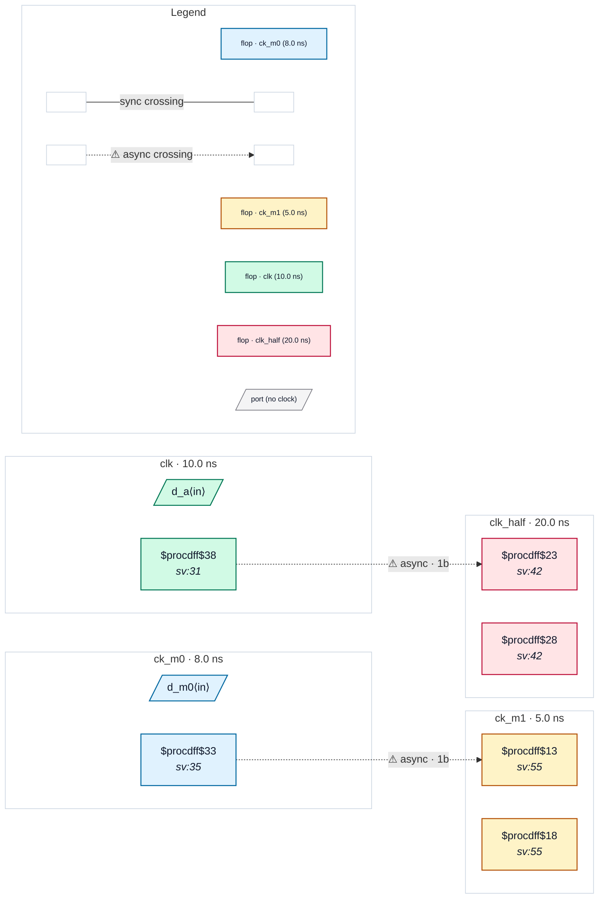

# Fixture: `good_datapath_only_overrides`

<!-- generator: scripts/gen_fixture_docs.py -->

Positive fixture: set_max_delay -datapath_only overriding a generated clock relation and an exclusive group (rtl-buddy-cdc#331).

clk_half is a create_generated_clock -divide_by 2 of clk (brought in on its own port), and ck_m0 / ck_m1 are -physically_exclusive. On their own, the first pair would be synchronous (same root) and the second unreachable. Each pair also carries a clock-to-clock `set_max_delay -datapath_only`, which bounds only the datapath of a path whose clocks are not timed against each other and which its author believes is live. A datapath-only pair wins over both the generated collapse and the exclusive group, so both crossings are checked as asynchronous; both land in a 2FF synchroniser. Two async crossings, no finding.

```text
  [a_q] clk   ──2FF──▶ clk_half   (generated ÷2, datapath-only)
  [m0_q] ck_m0 ──2FF──▶ ck_m1      (exclusive, datapath-only)
```

- **Status:** positive — textbook fix; analyzer must stay silent
- **Top module:** `good_datapath_only_overrides`
- **Clocks:** `ck_m0` (8.0 ns), `ck_m1` (5.0 ns), `clk` (10.0 ns), `clk_half` (20.0 ns)
- **Crossings:** 2 structural (2 async-per-SDC, 0 sync)

## Clock-domain map



## Files

- `good_datapath_only_overrides.json`
- `good_datapath_only_overrides.sdc`
- `good_datapath_only_overrides.sv`

---
*Generated by `scripts/gen_fixture_docs.py` — re-run after editing the SV/SDC/netlist.*
