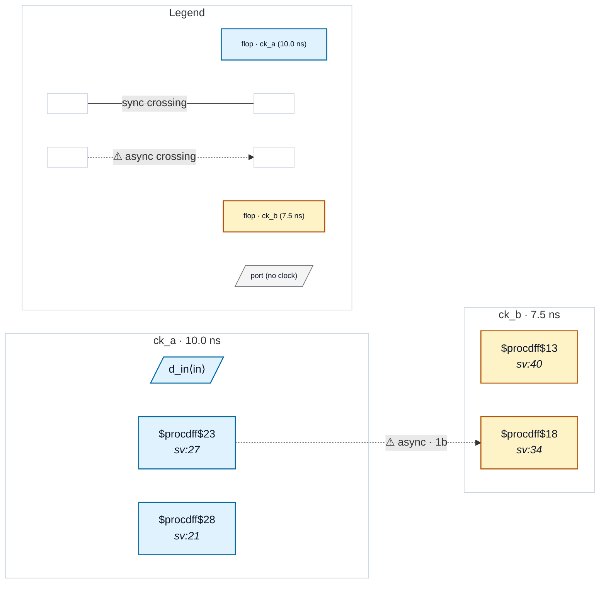

# Fixture: `good_datapath_only_pair`

<!-- generator: scripts/gen_fixture_docs.py -->

Positive fixture for set_max_delay -datapath_only as an async hint.

Two unrelated clock domains, ck_a and ck_b, with a flop→flop wire between them. The SDC declares nothing async — no set_clock_groups, no set_false_path — only a clock-to-clock `set_max_delay -datapath_only` bounding the crossing's datapath. That bound exists only where the two clocks are not timed against each other, so the analyzer reads it as an intended async crossing (rtl-buddy-cdc#325) and checks it. A 2FF synchronizer is in place, so no violation fires.

- **Status:** positive — textbook fix; analyzer must stay silent
- **Top module:** `good_datapath_only_pair`
- **Clocks:** `ck_a` (10.0 ns), `ck_b` (7.5 ns)
- **Crossings:** 1 structural (1 async-per-SDC, 0 sync)

## Clock-domain map

## Files

- `good_datapath_only_pair.json`
- `good_datapath_only_pair.sdc`
- `good_datapath_only_pair.sv`

---
*Generated by `scripts/gen_fixture_docs.py` — re-run after editing the SV/SDC/netlist.*
