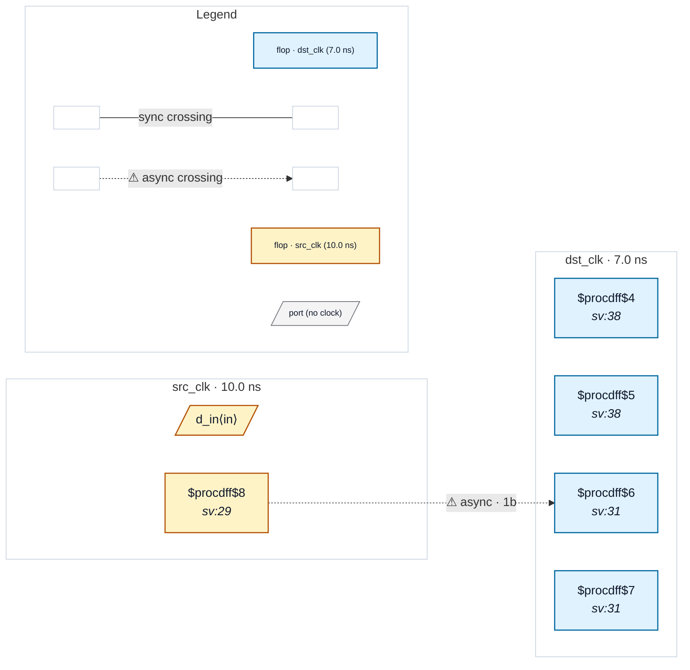

# Fixture: `good_exported_sync_stage`

<!-- generator: scripts/gen_fixture_docs.py -->

Positive counterpart of bad_exported_sync_stage: a textbook two-flop synchroniser whose *last* stage is exported straight to an output port and also feeds a two-register output pipeline. Must be clean.

The first stage `dst_meta` has exactly one reader (`dst_sync`), so the chain is two flops deep. Exporting the last stage is the normal way to use a synchronised value, and the tap ends the chain there: the pipeline registers behind it are not extra synchroniser stages, so the four same-domain flops in a row are not a cascade (no CDC-018).

```text
       src_clk          dst_clk
  [ src_q ] ─► [ dst_meta ] ─► [ dst_sync ] ─► [ pipe0 ] ─► [ q_pipe ]
                                    └─────────────────────► q_tap
Issue: rtl-buddy-cdc#344
```

- **Status:** positive — textbook fix; analyzer must stay silent
- **Top module:** `good_exported_sync_stage`
- **Clocks:** `dst_clk` (7.0 ns), `src_clk` (10.0 ns)
- **Crossings:** 1 structural (1 async-per-SDC, 0 sync)

## Clock-domain map



## Files

- `good_exported_sync_stage.json`
- `good_exported_sync_stage.sdc`
- `good_exported_sync_stage.sv`

---
*Generated by `scripts/gen_fixture_docs.py` — re-run after editing the SV/SDC/netlist.*
