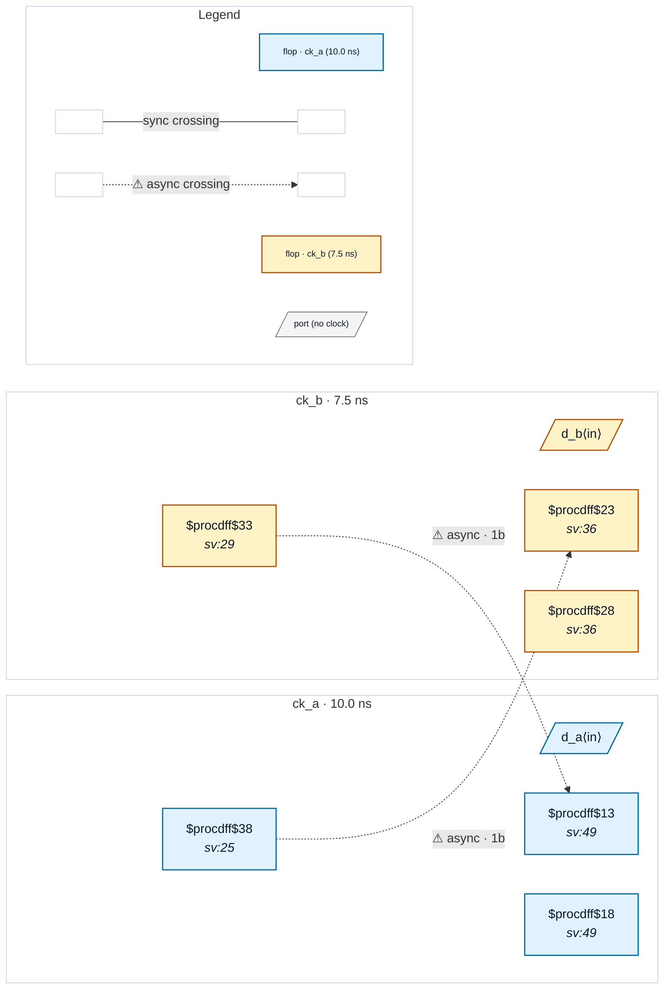

# Fixture: `good_false_path_one_direction`

<!-- generator: scripts/gen_fixture_docs.py -->

Positive fixture: a clock-pair set_false_path written in one direction only, with crossings in both directions (rtl-buddy-cdc#331).

The SDC declares no clock groups; the only relation between ck_a and ck_b is `set_false_path -from [get_clocks ck_a] -to [get_clocks ck_b]`. A clock-pair false path is read as declaring the PAIR asynchronous (README "SDC support": equivalent to declaring A and B async), so both directions are checked, not just the one written. Here both directions land in a 2FF synchroniser: two async crossings, no finding.

```text
  [a_q] ck_a ──2FF──▶ ck_b      (the false-path direction)
  [b_q] ck_b ──2FF──▶ ck_a      (the reverse direction)
```

- **Status:** positive — textbook fix; analyzer must stay silent
- **Top module:** `good_false_path_one_direction`
- **Clocks:** `ck_a` (10.0 ns), `ck_b` (7.5 ns)
- **Crossings:** 2 structural (2 async-per-SDC, 0 sync)

## Clock-domain map



## Files

- `good_false_path_one_direction.json`
- `good_false_path_one_direction.sdc`
- `good_false_path_one_direction.sv`

---
*Generated by `scripts/gen_fixture_docs.py` — re-run after editing the SV/SDC/netlist.*
