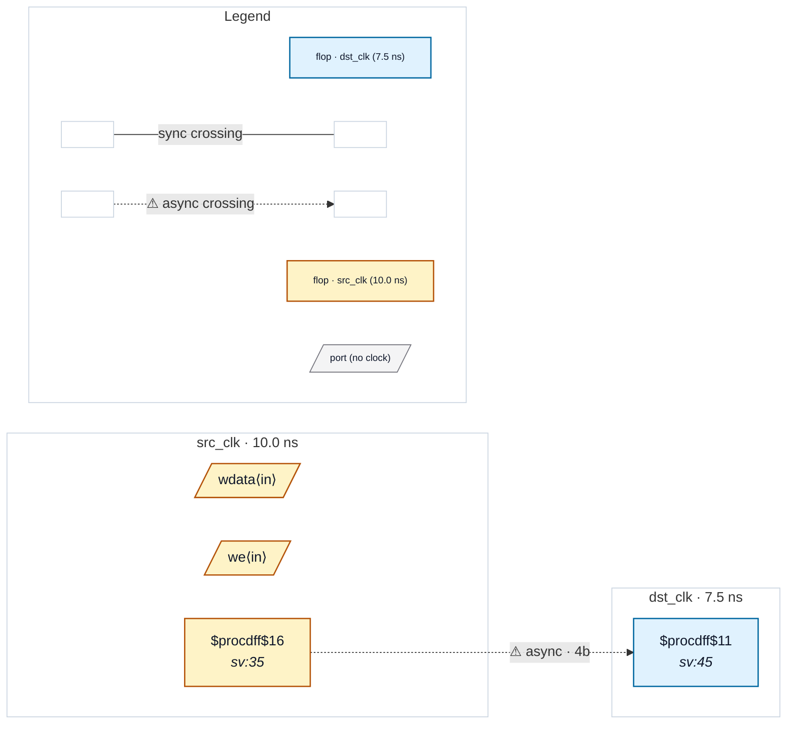

# Fixture: `good_false_path_through_bus`

<!-- generator: scripts/gen_fixture_docs.py -->

Positive fixture: a quasi-static bus crossing acknowledged by an object-scoped set_false_path -through (rtl-buddy-cdc#331).

src_clk and dst_clk are asynchronous. A 4-bit configuration register, cfg_q, written in src_clk, is routed through the pass-through instance u_bridge and captured by a single 4-bit dst_clk register: on its own a CDC-004 multi-bit crossing. The SDC pins the path with `set_false_path -through [get_pins u_bridge/cfg_o]`. Every path from cfg_q to the capture register passes that pin, so the statement covers the crossing and, by pinning the path, acknowledges it: CDC-004 moves to the suppressed list with the SDC statement as the reason. The run is clean (exit 0) and reports one suppressed finding.

```text
  [cfg_q] src_clk ─4b─▶ u_bridge/cfg_o ─4b─▶ [cfg_cap] dst_clk
                        └ set_false_path -through ⇒ CDC-004 suppressed
```

- **Status:** positive — textbook fix; analyzer must stay silent
- **Top module:** `good_false_path_through_bus`
- **Clocks:** `dst_clk` (7.5 ns), `src_clk` (10.0 ns)
- **Crossings:** 1 structural (1 async-per-SDC, 0 sync)

## Clock-domain map



## Files

- `good_false_path_through_bus.json`
- `good_false_path_through_bus.sdc`
- `good_false_path_through_bus.sv`

---
*Generated by `scripts/gen_fixture_docs.py` — re-run after editing the SV/SDC/netlist.*
