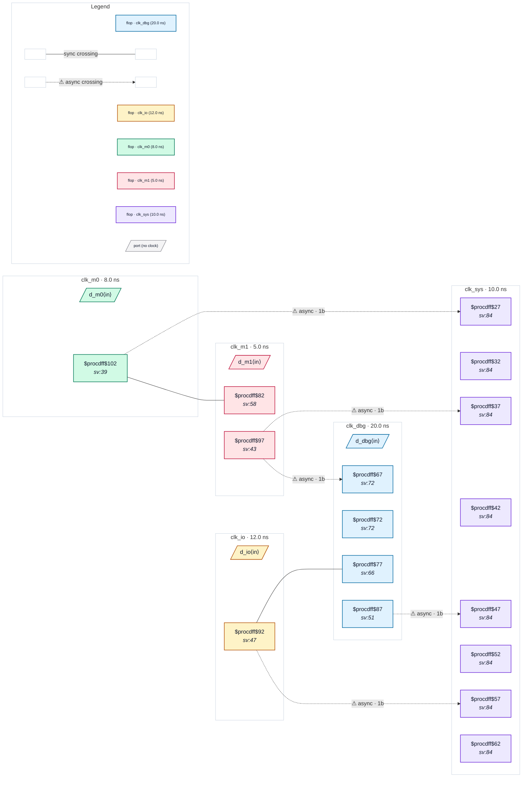

# Fixture: `good_five_clock_exclusive`

<!-- generator: scripts/gen_fixture_docs.py -->

Positive fixture: five clocks mixing asynchronous and exclusive groups, so some apparent crossings are unreachable (rtl-buddy-cdc#331).

```text
One set_clock_groups -asynchronous puts all five clocks in groups of
their own. Two more statements declare exclusive pairs:
clk_m0 / clk_m1 -physically_exclusive (two modes, only one clock is
ever running) and clk_io / clk_dbg -logically_exclusive (functional
vs debug mode). An apparent crossing between the two members of one
exclusive statement is unreachable and is dropped before any rule
runs, so its raw single-flop capture is not a finding:
  clk_m0 → clk_m1   raw  unreachable (physically exclusive)
  clk_io → clk_dbg  raw  unreachable (logically exclusive)
Every other crossing is reachable and asynchronous, and lands in a 2FF
synchroniser: m0 / m1 / io / dbg → clk_sys, and clk_m1 → clk_dbg (the
two exclusive statements do not relate clk_m1 to clk_dbg). Five async
crossings, no finding.
```

```text
  clk_m0 ─raw─▶ clk_m1   (excl)      clk_io ─raw─▶ clk_dbg   (excl)
  m0, m1, io, dbg ──2FF──▶ clk_sys    m1 ──2FF──▶ clk_dbg
```

- **Status:** positive — textbook fix; analyzer must stay silent
- **Top module:** `good_five_clock_exclusive`
- **Clocks:** `clk_dbg` (20.0 ns), `clk_io` (12.0 ns), `clk_m0` (8.0 ns), `clk_m1` (5.0 ns), `clk_sys` (10.0 ns)
- **Crossings:** 7 structural (5 async-per-SDC, 2 sync)

## Clock-domain map



## Files

- `good_five_clock_exclusive.json`
- `good_five_clock_exclusive.sdc`
- `good_five_clock_exclusive.sv`

---
*Generated by `scripts/gen_fixture_docs.py` — re-run after editing the SV/SDC/netlist.*
