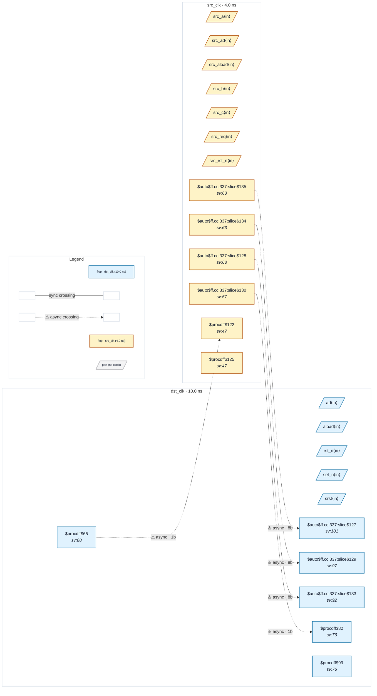

# Fixture: `good_flop_variety_handshake`

<!-- generator: scripts/gen_fixture_docs.py -->

Flop-type coverage on a correct handshake (rtl-buddy-cdc#331).

A req/ack handshake moves three held 8-bit payloads from src_clk to dst_clk. The flops on the crossings and their synchronisers are Yosys flop families the rest of the corpus barely produces. The committed netlist is built with `opt_dff` after `proc`, which folds the enable and sync-reset muxes into the flops:

```text
  ack_meta, ack_sync  $aldff   ack synchroniser, async load of src_ad
  req_s1, req_s2      $dffsr   req synchroniser, async clear and set
  cap_a               $dffsre  capture, async clear and set, enable
  cap_b               $aldffe  capture, async load of ad, enable
  cap_c               $sdffce  capture, sync reset only while loading
```

Each payload has its own register, held from request until the acknowledge returns, and each capture loads on the synchronised request, so CDC-004 and CDC-012 accept all three buses. Nothing fires.

Known gaps, pinned as strict xfails: at gate level the 8-bit `$dffsre` stays eight one-bit flops (proc gives every lane its own SET / CLR net), so CDC-020 fires there; the slang frontend lowers each async load as a reset to 0 and the async set as synchronous logic, so it reports CDC-014 between req_s1 and req_s2.

- **Status:** positive — textbook fix; analyzer must stay silent
- **Top module:** `good_flop_variety_handshake`
- **Clocks:** `dst_clk` (10.0 ns), `src_clk` (4.0 ns)
- **Crossings:** 5 structural (5 async-per-SDC, 0 sync)

## Clock-domain map



## Files

- `good_flop_variety_handshake.json`
- `good_flop_variety_handshake.sdc`
- `good_flop_variety_handshake.sv`

---
*Generated by `scripts/gen_fixture_docs.py` — re-run after editing the SV/SDC/netlist.*
