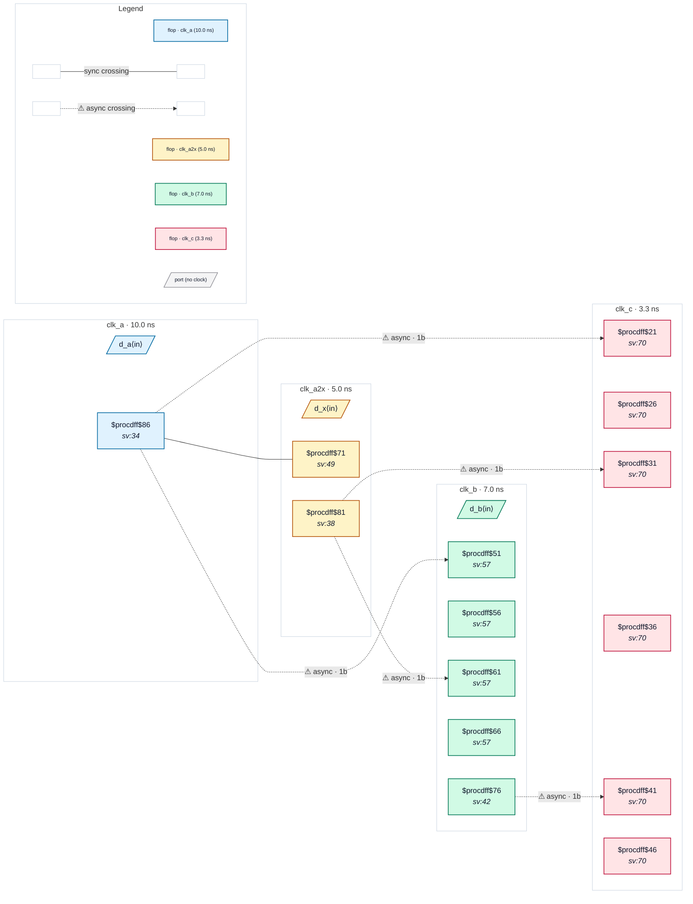

# Fixture: `good_four_clock_mixed`

<!-- generator: scripts/gen_fixture_docs.py -->

Positive fixture: four clocks, two synchronous and two asynchronous, with a crossing for every clock pair (rtl-buddy-cdc#331).

```text
clk_a2x is a create_generated_clock -multiply_by 2 of clk_a (a PLL
output brought in on its own port), so clk_a and clk_a2x share a
root. One set_clock_groups -asynchronous puts both in the first
group and clk_b, clk_c in groups of their own. Six pairs:
  clk_a  → clk_a2x  same root, raw single flop: synchronous, no check
  clk_a  → clk_b    2FF        clk_a  → clk_c    2FF
  clk_a2x→ clk_b    2FF        clk_a2x→ clk_c    2FF
  clk_b  → clk_c    2FF
Five async crossings, each into a 2FF synchroniser: clean.
```

```text
  group 1: clk_a, clk_a2x (×2)   group 2: clk_b   group 3: clk_c
  [a_q]──raw──▶[x_cap]            [b_*_s2]          [c_*_s2]
  a_q, x_q ──2FF──▶ clk_b   a_q, x_q, b_q ──2FF──▶ clk_c
```

- **Status:** positive — textbook fix; analyzer must stay silent
- **Top module:** `good_four_clock_mixed`
- **Clocks:** `clk_a` (10.0 ns), `clk_a2x` (5.0 ns), `clk_b` (7.0 ns), `clk_c` (3.3 ns)
- **Crossings:** 6 structural (5 async-per-SDC, 1 sync)

## Clock-domain map



## Files

- `good_four_clock_mixed.json`
- `good_four_clock_mixed.sdc`
- `good_four_clock_mixed.sv`

---
*Generated by `scripts/gen_fixture_docs.py` — re-run after editing the SV/SDC/netlist.*
