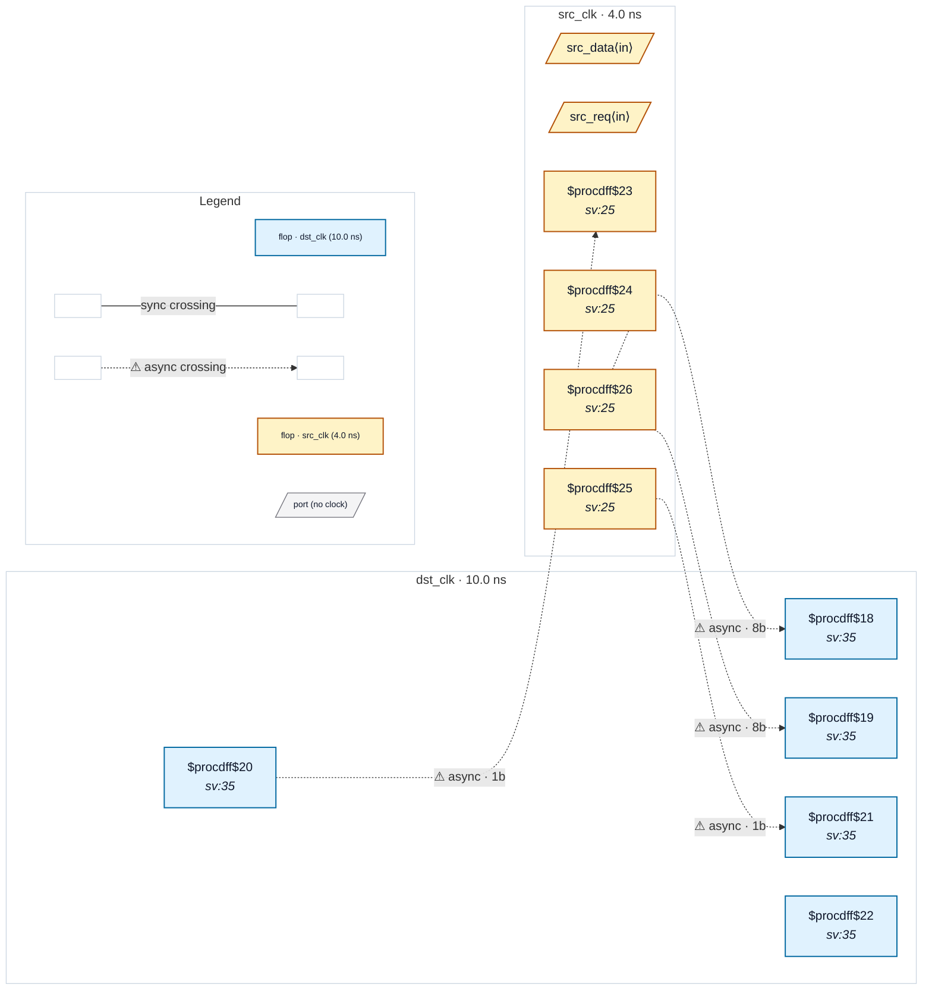

# Fixture: `good_gated_bus_double_capture`

<!-- generator: scripts/gen_fixture_docs.py -->

Two full-width gated captures of one held payload (rtl-buddy-cdc#386).

A req/ack handshake holds the 8-bit src_clk register `payload` from request until the acknowledge returns. dst_clk captures it twice, into `cap_a` and `cap_b`, each loading all eight bits under the same synchronised request `req_s2`. Each capture is a properly gated bus (CDC-004 silent, CDC-012 silent: the acknowledge closes the loop).

CDC-020 used to read the two destinations of `payload` as two lanes of a sliced bus. Its lanes are crossings narrower than the source; a crossing that lands the whole bus on one register is a bus crossing, so nothing fires.

- **Status:** positive — textbook fix; analyzer must stay silent
- **Top module:** `good_gated_bus_double_capture`
- **Clocks:** `dst_clk` (10.0 ns), `src_clk` (4.0 ns)
- **Crossings:** 4 structural (4 async-per-SDC, 0 sync)

## Clock-domain map

## Files

- `good_gated_bus_double_capture.json`
- `good_gated_bus_double_capture.sdc`
- `good_gated_bus_double_capture.sv`

---
*Generated by `scripts/gen_fixture_docs.py` — re-run after editing the SV/SDC/netlist.*
