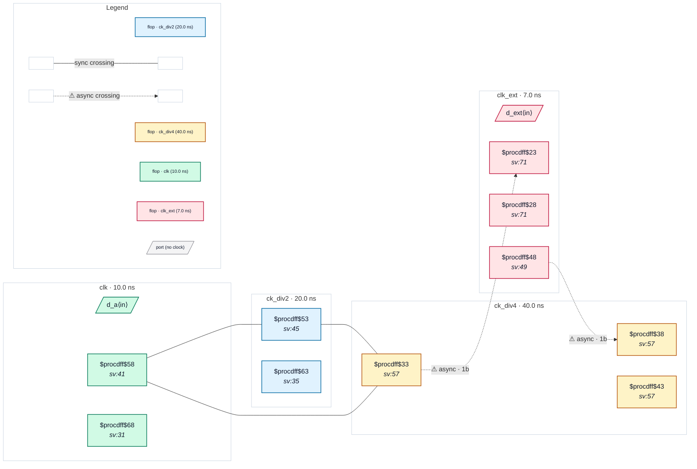

# Fixture: `good_gen_clock_chain`

<!-- generator: scripts/gen_fixture_docs.py -->

Positive fixture: a generated clock of a generated clock (rtl-buddy-cdc#331).

clk drives a divide-by-2 toggle flop whose output net div2_q is declared ck_div2 (create_generated_clock -divide_by 2 on the pin). ck_div2 drives a second toggle flop, div4_q, declared ck_div4 with -master_clock ck_div2. Both collapse to the root clk, so the raw single-flop paths clk → ck_div4 and ck_div2 → ck_div4 are synchronous: STA times them and they are not CDC crossings. clk_ext is asynchronous to clk (set_clock_groups -asynchronous names the roots); it reaches ck_div4 through the root, so clk_ext → ck_div4 and ck_div4 → clk_ext are async crossings, each into a 2FF synchroniser. Two async crossings, no finding.

```text
  clk ─▶ [div2_q] = ck_div2 ─▶ [div4_q] = ck_div4
  [a_q] (clk) ──raw──▶ [d4_cap] ◀──raw── [d2_q] (ck_div2)   synchronous
  clk_ext ──2FF──▶ ck_div4 ──2FF──▶ clk_ext                 async, synced
```

- **Status:** positive — textbook fix; analyzer must stay silent
- **Top module:** `good_gen_clock_chain`
- **Clocks:** `ck_div2` (20.0 ns), `ck_div4` (40.0 ns), `clk` (10.0 ns), `clk_ext` (7.0 ns)
- **Crossings:** 5 structural (2 async-per-SDC, 3 sync)

## Clock-domain map



## Files

- `good_gen_clock_chain.json`
- `good_gen_clock_chain.sdc`
- `good_gen_clock_chain.sv`

---
*Generated by `scripts/gen_fixture_docs.py` — re-run after editing the SV/SDC/netlist.*
