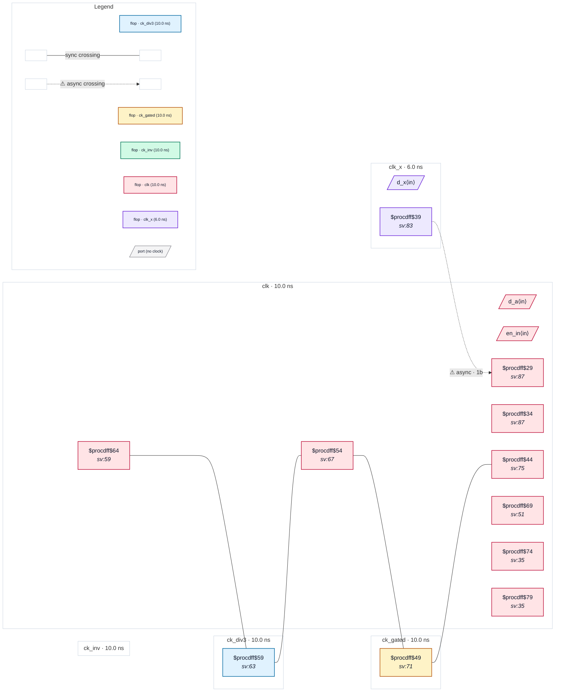

# Fixture: `good_gen_clock_edges_invert`

<!-- generator: scripts/gen_fixture_docs.py -->

Positive fixture: generated clocks declared with -edges, -invert and -combinational (rtl-buddy-cdc#331).

```text
Three clocks are derived from clk inside the design and declared on
internal pins:
  ck_div3   -edges {1 3 7}: a divide-by-3 counter's registered output
            (high one clk cycle in three)
  ck_inv    -invert -divide_by 1: clk through an inverter
  ck_gated  -combinational: clk ANDed with a falling-edge enable flop
Each has -master_clock clk, so all three collapse to the root clk and
every path among clk, ck_div3, ck_inv and ck_gated is synchronous: the
raw single-flop chain clk → ck_div3 → ck_inv → ck_gated → clk is
timed by STA, not a CDC crossing. clk_x is asynchronous to clk (the
group names the root) and enters clk through a 2FF synchroniser. One
async crossing, no finding.
```

```text
  [a_q] clk ─raw─▶ [d3_q] ck_div3 ─raw─▶ [inv_q] ck_inv
    ─raw─▶ [g_q] ck_gated ─raw─▶ [back_q] clk          synchronous
  [x_q] clk_x ──2FF──▶ clk
```

- **Status:** positive — textbook fix; analyzer must stay silent
- **Top module:** `good_gen_clock_edges_invert`
- **Clocks:** `ck_div3` (10.0 ns), `ck_gated` (10.0 ns), `ck_inv` (10.0 ns), `clk` (10.0 ns), `clk_x` (6.0 ns)
- **Crossings:** 5 structural (1 async-per-SDC, 4 sync)

## Clock-domain map



## Files

- `good_gen_clock_edges_invert.json`
- `good_gen_clock_edges_invert.sdc`
- `good_gen_clock_edges_invert.sv`

---
*Generated by `scripts/gen_fixture_docs.py` — re-run after editing the SV/SDC/netlist.*
