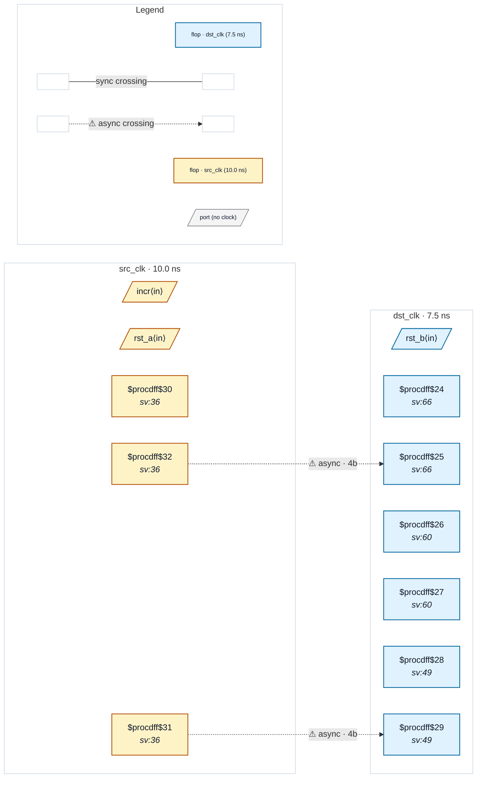

# Fixture: `good_gray_bus_sync_srst`

<!-- generator: scripts/gen_fixture_docs.py -->

Gray pointer into a multi-bit 2FF synchroniser whose stages carry a synchronous reset (rtl-buddy-cdc#366).

`if (rst) begin meta <= '0; q <= '0; end` lowers, after `proc`, to a constant-leg `$mux` in front of each stage's `D`, so stage 1's `Q` reaches stage 2 through that mux rather than directly. The reset only forces the lanes to a constant and moves no data between them: the chain is still a lane-aligned multi-bit synchroniser, and the gray source keeps CDC-004 silent. Two pointers cover both reset sources a synchroniser stage sees in practice: `gray_p` into stages reset by the primary reset port `rst_b`, and `gray_l` into stages reset by a local reset synchronised into dst_clk. The `.optdff.json` netlist is the same design after `opt_dff`, which folds each reset into a `$sdff`.

Paired with `good_gray_bus_sync_chain` (no reset) and with the negative `bad_bus_crossing`.

- **Status:** positive — textbook fix; analyzer must stay silent
- **Top module:** `good_gray_bus_sync_srst`
- **Clocks:** `dst_clk` (7.5 ns), `src_clk` (10.0 ns)
- **Crossings:** 2 structural (2 async-per-SDC, 0 sync)

## Clock-domain map

## Files

- `good_gray_bus_sync_srst.json`
- `good_gray_bus_sync_srst.optdff.json`
- `good_gray_bus_sync_srst.sdc`
- `good_gray_bus_sync_srst.sv`

---
*Generated by `scripts/gen_fixture_docs.py` — re-run after editing the SV/SDC/netlist.*
