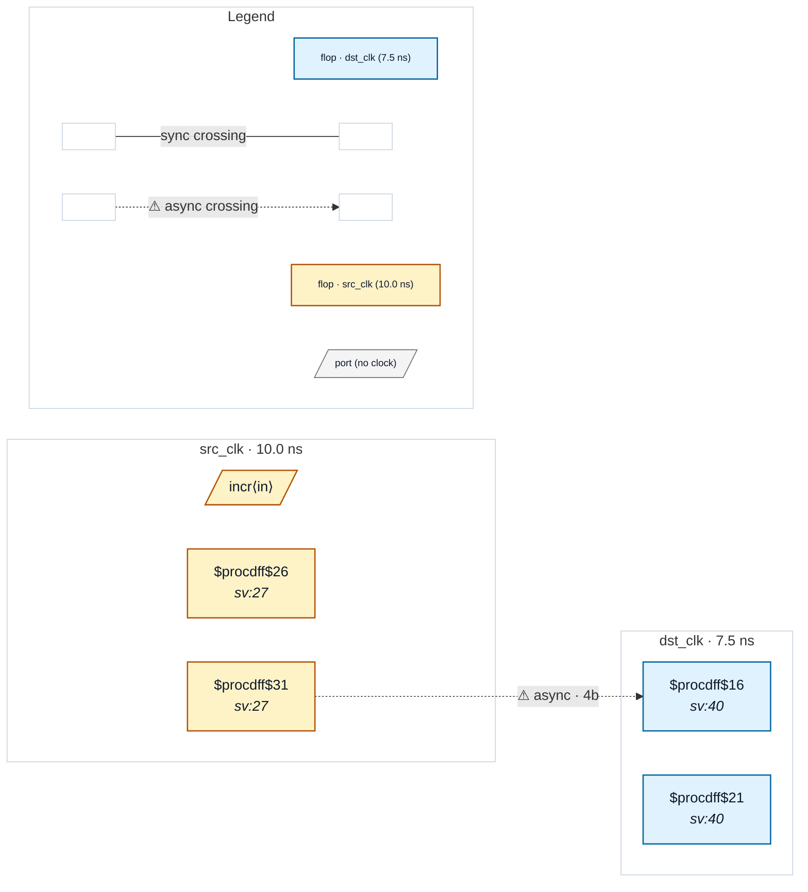

# Fixture: `good_gray_xor_swapped`

<!-- generator: scripts/gen_fixture_docs.py -->

Gray encoder written with the shifted operand first (rtl-buddy-cdc#365).

The same 4-bit gray counter and ungated 4-bit 2FF synchronizer as `good_gray_bus_sync_chain`, except the encoder reads `g = (b >> 1) ^ b`. XOR is commutative, so after flattening the shifted operand simply sits on the `$xor`'s A input instead of B. The structural gray detector (`_is_gray_encoded_source`) must match it in either order, and CDC-004 must not fire.

Paired with `good_gray_bus_sync_chain` (canonical order) and with the negative `bad_bus_crossing`.

- **Status:** positive — textbook fix; analyzer must stay silent
- **Top module:** `good_gray_xor_swapped`
- **Clocks:** `dst_clk` (7.5 ns), `src_clk` (10.0 ns)
- **Crossings:** 1 structural (1 async-per-SDC, 0 sync)

## Clock-domain map

## Files

- `good_gray_xor_swapped.json`
- `good_gray_xor_swapped.sdc`
- `good_gray_xor_swapped.sv`

---
*Generated by `scripts/gen_fixture_docs.py` — re-run after editing the SV/SDC/netlist.*
