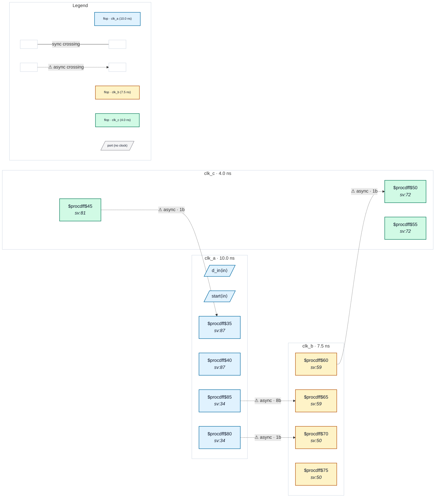

# Fixture: `good_handshake_ack_via_third_domain`

<!-- generator: scripts/gen_fixture_docs.py -->

Positive fixture: a req/ack bus handshake whose acknowledge returns through a third clock domain (rtl-buddy-cdc#331).

clk_a, clk_b and clk_c are mutually asynchronous. clk_a launches an 8-bit payload and a level request; clk_b synchronises the request (2FF) and loads the payload through a mux whose select is that synchronised request, so the bus crossing is gated (no CDC-004). clk_b's acknowledge does not go straight back: it is synchronised into clk_c (2FF), re-registered there (a bridge that forwards it), and synchronised from clk_c into clk_a (2FF). clk_a holds data_q and req_q until that acknowledge arrives, so the payload is stable for the whole time clk_b may sample it, which is the guarantee CDC-012 asks for. Four async crossings (payload, request, ack B → C, ack C → A), all gated or 2FF-synchronised. Expected verdict: clean.

```text
  clk_a [req_q, data_q] ──req 2FF──▶ clk_b [b_data ◀ mux(data_q)]
       ▲                                   │ b_ack_q
       └──2FF── clk_c [c_ack_q] ◀──2FF─────┘
```

- **Status:** positive — textbook fix; analyzer must stay silent
- **Top module:** `good_handshake_ack_via_third_domain`
- **Clocks:** `clk_a` (10.0 ns), `clk_b` (7.5 ns), `clk_c` (4.0 ns)
- **Crossings:** 4 structural (4 async-per-SDC, 0 sync)

## Clock-domain map



## Files

- `good_handshake_ack_via_third_domain.json`
- `good_handshake_ack_via_third_domain.sdc`
- `good_handshake_ack_via_third_domain.sv`

---
*Generated by `scripts/gen_fixture_docs.py` — re-run after editing the SV/SDC/netlist.*
