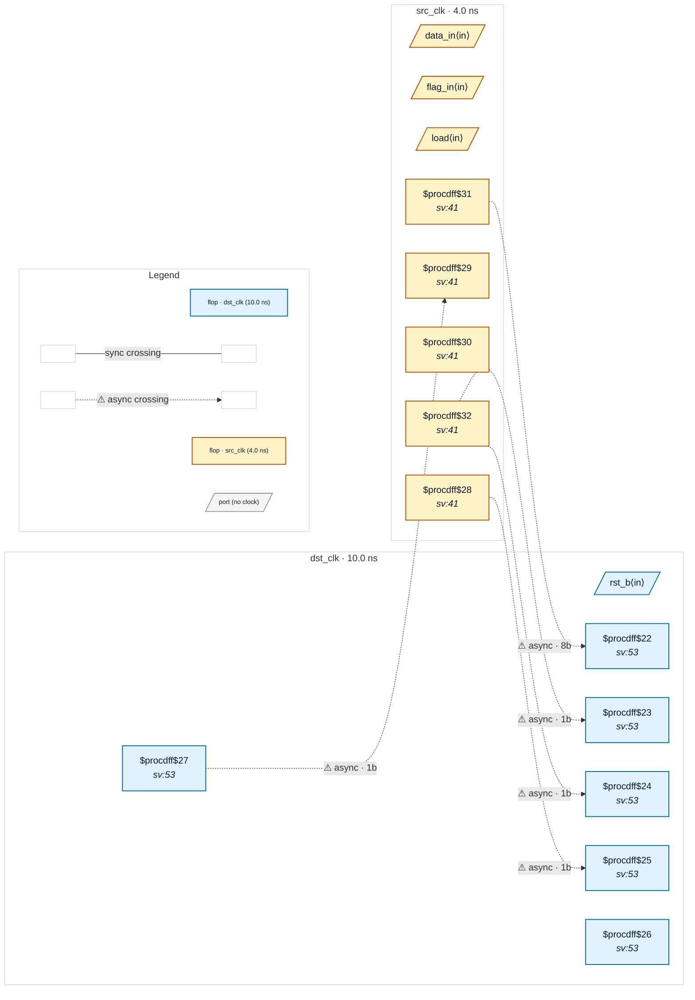

# Fixture: `good_handshake_single_bit`

<!-- generator: scripts/gen_fixture_docs.py -->

A 1-bit payload captured under a toggle handshake's synchronised enable (rtl-buddy-cdc#368).

src_clk loads an 8-bit `data_a` and a 1-bit `flag_a` (and flips the request toggle `tog_a`) only when the acknowledge, synchronised back into src_clk, says the previous transfer is done. dst_clk brings the toggle in through three flops and captures both registers on the toggle edge (`s2 ^ s3`). The flag is protected exactly as the bus is: held by the source until the acknowledge returns, sampled only on the synchronised edge. CDC-004 accepts the bus as a gated crossing; CDC-001 must accept the flag the same way. `flag_r` is a second capture of the flag whose register also has a synchronous dst_clk reset, so `proc` leaves a reset mux in front of its hold mux.

The `.optdff.json` netlist is the same design after `opt_dff`, which folds both captures' hold muxes into `$dffe` enables; the `.synth.json` netlist is the gate-level synth leg (`$_DFFE_*`).

Paired with `bad_handshake_single_bit` (free-running, unsynchronised, third-domain and open-loop enables, and a data-select mux).

- **Status:** positive — textbook fix; analyzer must stay silent
- **Top module:** `good_handshake_single_bit`
- **Clocks:** `dst_clk` (10.0 ns), `src_clk` (4.0 ns)
- **Crossings:** 5 structural (5 async-per-SDC, 0 sync)

## Clock-domain map

## Files

- `good_handshake_single_bit.json`
- `good_handshake_single_bit.optdff.json`
- `good_handshake_single_bit.sdc`
- `good_handshake_single_bit.sv`
- `good_handshake_single_bit.synth.json`

---
*Generated by `scripts/gen_fixture_docs.py` — re-run after editing the SV/SDC/netlist.*
