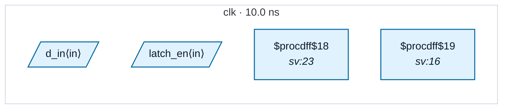

# Fixture: `good_latch_in_same_domain`

<!-- generator: scripts/gen_fixture_docs.py -->

Positive counterpart for CDC-017.

A transparent latch is fine when source and destination flops share a clock domain — no CDC at all. CDC-017 must stay silent here even though structurally the latch sits between two flops: the rule only fires when src_clock != dst_clock.

- **Status:** positive — textbook fix; analyzer must stay silent
- **Top module:** `good_latch_in_same_domain`
- **Clocks:** `clk` (10.0 ns)
- **Crossings:** 0 structural (0 async-per-SDC, 0 sync)

## Clock-domain map

## Files

- `good_latch_in_same_domain.json`
- `good_latch_in_same_domain.sdc`
- `good_latch_in_same_domain.sv`

---
*Generated by `scripts/gen_fixture_docs.py` — re-run after editing the SV/SDC/netlist.*
