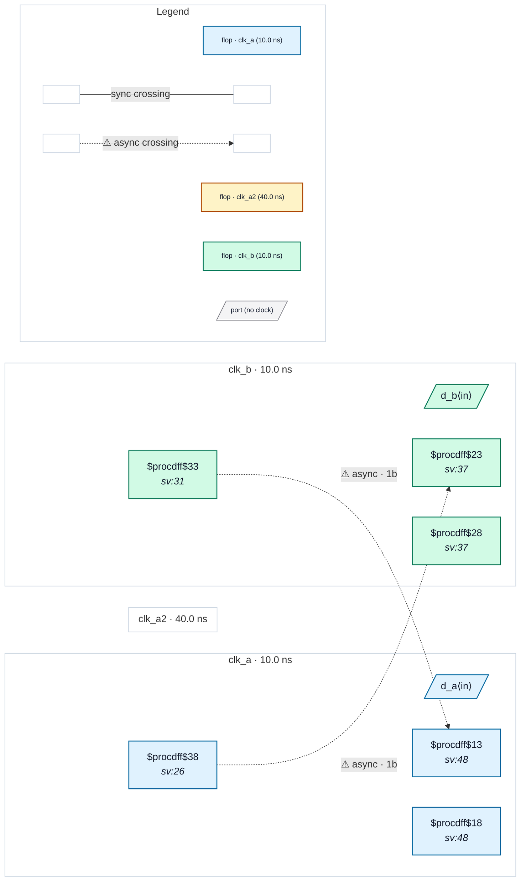

# Fixture: `good_multi_clock_port`

<!-- generator: scripts/gen_fixture_docs.py -->

Positive fixture for a port carrying two clocks (create_clock -add).

Same clocks as bad_multi_clock_port: port clk_a carries clk_a (synchronous to clk_b) and clk_a2 (added with -add, asynchronous to clk_b). Each crossing now lands in a 2FF synchroniser, so the clk_a2 reading of both crossings is safe and no rule fires (rtl-buddy-cdc#330).

```text
     clk_a (+clk_a2)                clk_b
  ┌──[ a_q ]────────────────[ b_s1 ]─[ b_s2 ]
  └──[ a_s2 ]─[ a_s1 ]──────────────[ b_q ]──┘
  2FF synchroniser each way → clean
```

- **Status:** positive — textbook fix; analyzer must stay silent
- **Top module:** `good_multi_clock_port`
- **Clocks:** `clk_a` (10.0 ns), `clk_a2` (40.0 ns), `clk_b` (10.0 ns)
- **Crossings:** 2 structural (2 async-per-SDC, 0 sync)

## Clock-domain map



## Files

- `good_multi_clock_port.json`
- `good_multi_clock_port.sdc`
- `good_multi_clock_port.sv`

---
*Generated by `scripts/gen_fixture_docs.py` — re-run after editing the SV/SDC/netlist.*
