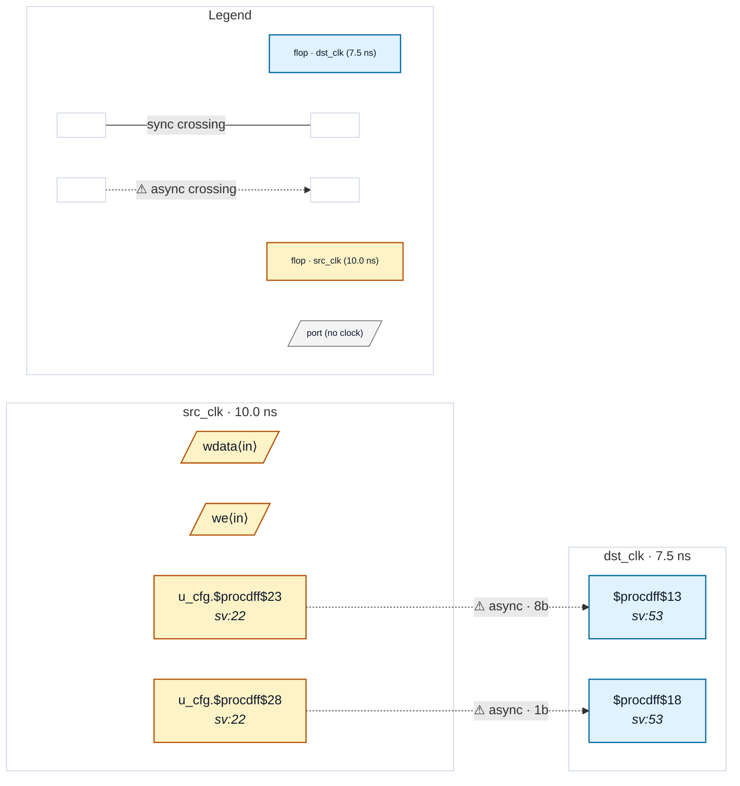

# Fixture: `good_object_false_path`

<!-- generator: scripts/gen_fixture_docs.py -->

Positive fixture for an object-scoped set_false_path (#328).

A configuration block u_cfg holds an 8-bit mode register and a 1-bit enable, both written in src_clk and read in dst_clk by single capture flops with no synchroniser. Structurally that is CDC-004 (the bus) and CDC-001 (the bit). The SDC declares both sources static with object-scoped false paths written the way synthesis SDCs name registers (u_cfg/mode_q_reg*, u_cfg/enable_q_reg/Q), so both findings are acknowledged: reported as suppressed with the SDC statement as the reason, not dropped, and the run exits clean.

- **Status:** positive — textbook fix; analyzer must stay silent
- **Top module:** `good_object_false_path`
- **Clocks:** `dst_clk` (7.5 ns), `src_clk` (10.0 ns)
- **Crossings:** 2 structural (2 async-per-SDC, 0 sync)

## Clock-domain map

## Files

- `good_object_false_path.json`
- `good_object_false_path.sdc`
- `good_object_false_path.sv`

---
*Generated by `scripts/gen_fixture_docs.py` — re-run after editing the SV/SDC/netlist.*
