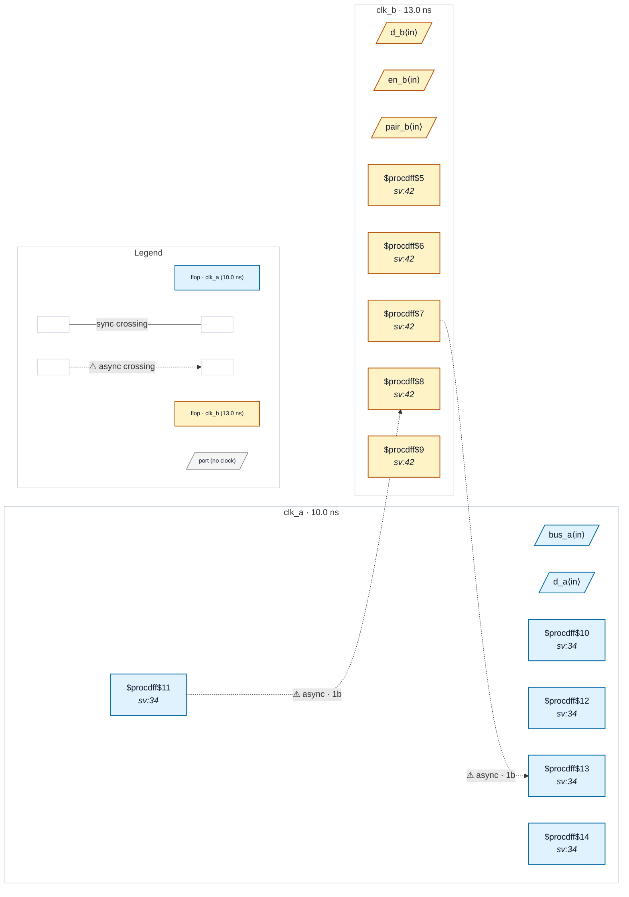

# Fixture: `good_output_async_merge_synced`

<!-- generator: scripts/gen_fixture_docs.py -->

Positive pair of bad_output_async_merge (CDC-025, issue #329): the same outputs, each now launched from a single domain. The clk_a flag is 2FF-synchronised into clk_b before irq ORs it with the clk_b flag, and the clk_b enable is 2FF-synchronised into clk_a before it gates the clk_a bus onto status. mixed (a clk_a pair next to a clk_b pair, no bit merging them) and q_a are unchanged. No output carries a set_output_delay contract, so single-domain outputs are not reported: CDC-025 must stay silent, and so must every other rule.

- **Status:** positive — textbook fix; analyzer must stay silent
- **Top module:** `good_output_async_merge_synced`
- **Clocks:** `clk_a` (10.0 ns), `clk_b` (13.0 ns)
- **Crossings:** 2 structural (2 async-per-SDC, 0 sync)

## Clock-domain map

## Files

- `good_output_async_merge_synced.json`
- `good_output_async_merge_synced.sdc`
- `good_output_async_merge_synced.sv`

---
*Generated by `scripts/gen_fixture_docs.py` — re-run after editing the SV/SDC/netlist.*
