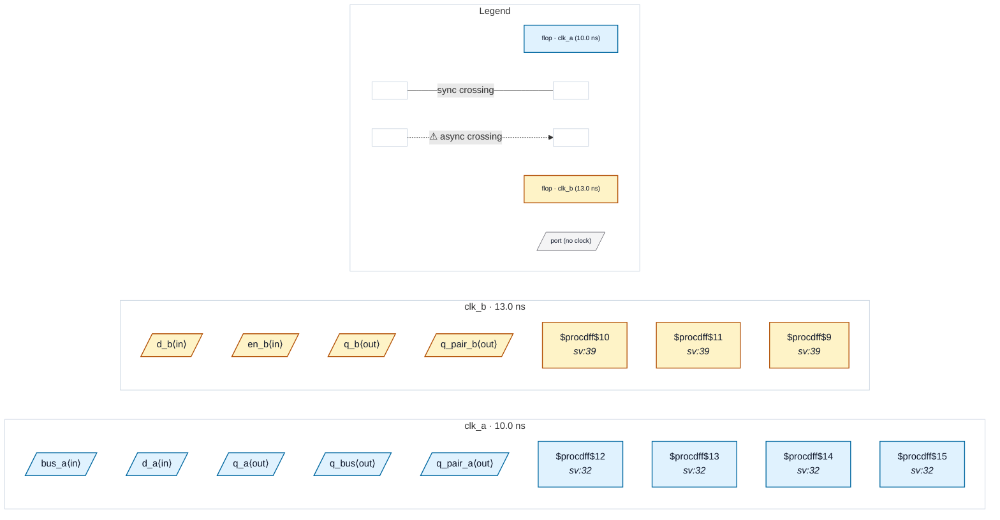

# Fixture: `good_output_contracts_complete`

<!-- generator: scripts/gen_fixture_docs.py -->

Positive pair of bad_output_missing_contract (CDC-025, issue #329): the same design with every data output contracted. q_b and q_bus get their set_output_delay -clock, and the mixed-domain pair is split into one port per launch domain (q_pair_a, q_pair_b) so each can carry its own contract. The clock, constant and feed-through outputs need none. CDC-025 must stay silent, and so must every other rule.

- **Status:** positive — textbook fix; analyzer must stay silent
- **Top module:** `good_output_contracts_complete`
- **Clocks:** `clk_a` (10.0 ns), `clk_b` (13.0 ns)
- **Crossings:** 0 structural (0 async-per-SDC, 0 sync)

## Clock-domain map

## Files

- `good_output_contracts_complete.json`
- `good_output_contracts_complete.sdc`
- `good_output_contracts_complete.sv`

---
*Generated by `scripts/gen_fixture_docs.py` — re-run after editing the SV/SDC/netlist.*
