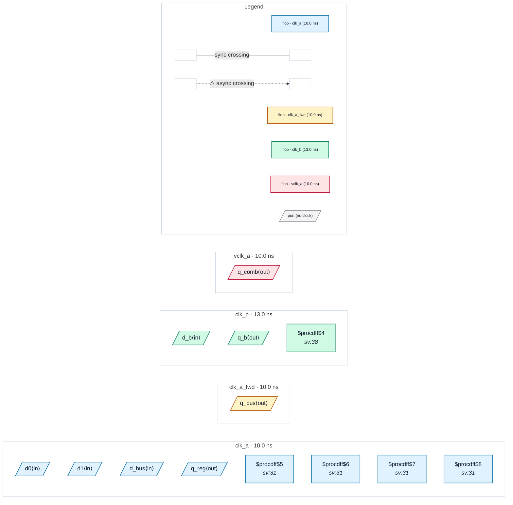

# Fixture: `good_output_sync_contract`

<!-- generator: scripts/gen_fixture_docs.py -->

Positive fixture for CDC-024 (issue #323): every top-level output carries a set_output_delay contract whose receiving clock is related to the clock that launches it, so CDC-024 must stay silent even though most of the contract clock names differ from the launch clock.

q_reg is contracted to clk_a itself (same domain). q_comb, a combinational cone of two clk_a flops, is contracted to vclk_a, a virtual clock the SDC never declares asynchronous to clk_a. q_bus is contracted to clk_a_fwd, a generated clock of clk_a forwarded out on clk_fwd (a source-synchronous interface). q_b is launched and contracted in a second clock, clk_b. The SDC does declare clk_a and clk_b asynchronous, so the rule runs against real async groups.

- **Status:** positive — textbook fix; analyzer must stay silent
- **Top module:** `good_output_sync_contract`
- **Clocks:** `clk_a` (10.0 ns), `clk_a_fwd` (10.0 ns), `clk_b` (13.0 ns), `vclk_a` (10.0 ns)
- **Crossings:** 0 structural (0 async-per-SDC, 0 sync)

## Clock-domain map

## Files

- `good_output_sync_contract.json`
- `good_output_sync_contract.sdc`
- `good_output_sync_contract.sv`

---
*Generated by `scripts/gen_fixture_docs.py` — re-run after editing the SV/SDC/netlist.*
