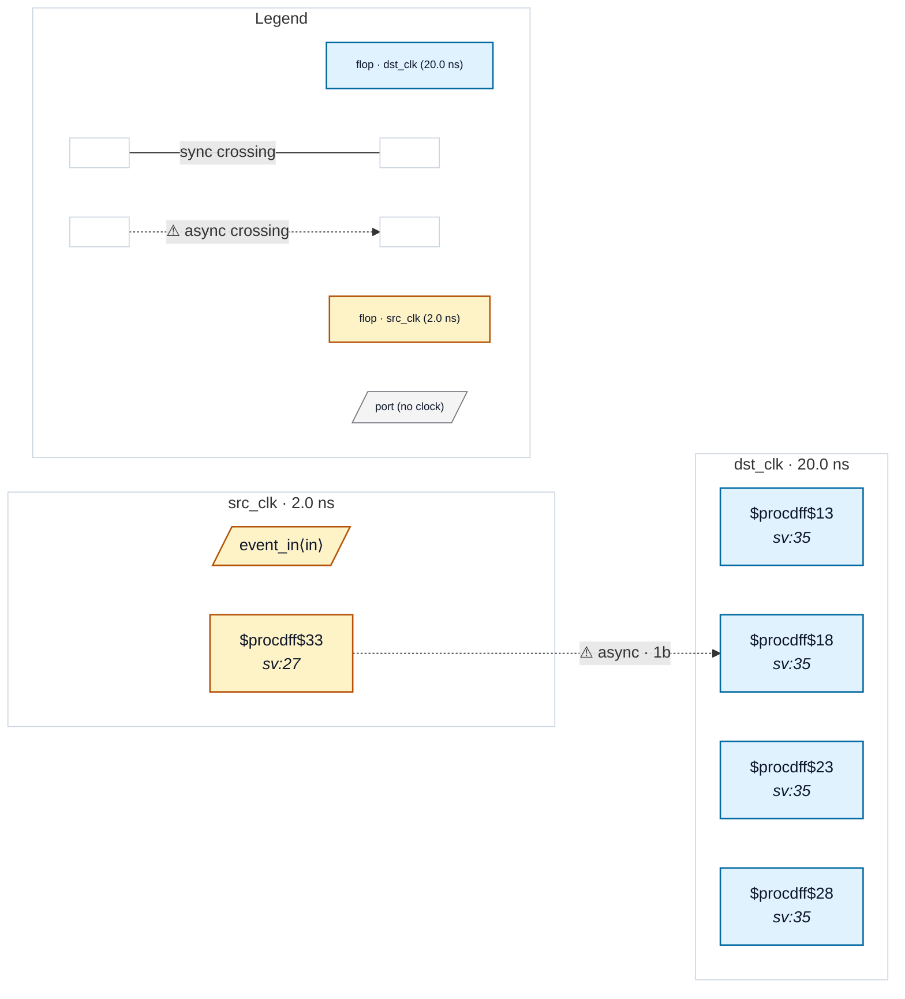

# Fixture: `good_pulse_synchronizer`

<!-- generator: scripts/gen_fixture_docs.py -->

Positive fixture: canonical pulse synchroniser for fast-to-slow event passing.

Source-side toggle flop converts edges to level changes; the destination's 2FF chain synchronises the toggle; an XOR of the chain tail with its 1-cycle-delayed copy (toggle_sync ^ toggle_sync_d) recovers one pulse per event in the destination clock domain. This is the textbook correct idiom (Cummings SNUG 2008 §6) — no event loss for events spaced more than ~2 dst cycles apart.

CDC-013 must stay silent here: the source-side toggle pattern matches the rule's classifier, but the dst-side XOR-tail proves the chain reconstructs the pulse correctly. The XOR-tail recognition was added in rtl-buddy-cdc#196 — before that, this fixture false-fired CDC-013.

- **Status:** positive — textbook fix; analyzer must stay silent
- **Top module:** `good_pulse_synchronizer`
- **Clocks:** `dst_clk` (20.0 ns), `src_clk` (2.0 ns)
- **Crossings:** 1 structural (1 async-per-SDC, 0 sync)

## Clock-domain map

## Files

- `good_pulse_synchronizer.json`
- `good_pulse_synchronizer.sdc`
- `good_pulse_synchronizer.sv`
- `good_pulse_synchronizer.synth.json`

---
*Generated by `scripts/gen_fixture_docs.py` — re-run after editing the SV/SDC/netlist.*
