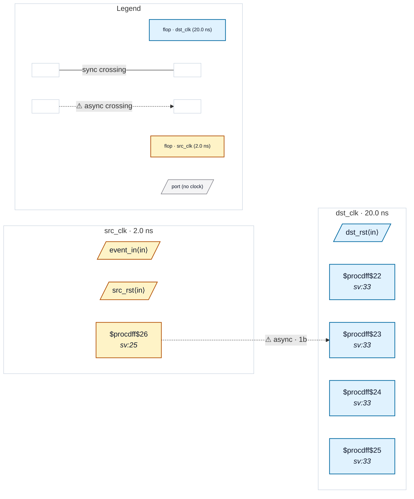

# Fixture: `good_pulse_synchronizer_srst`

<!-- generator: scripts/gen_fixture_docs.py -->

Canonical pulse synchroniser whose flops carry a synchronous reset (rtl-buddy-cdc#376).

The same toggle + 2FF + XOR-tail idiom as `good_pulse_synchronizer`, with `if (rst) ... <= 1'b0;` in place of the asynchronous reset. After `proc` every reset is a constant-leg `$mux` in front of the flop's `D`: the source toggle's `D` is `rst ? 0 : (event ? ~q : q)`, and the delayed copy `toggle_sync_d` reads `toggle_sync` through its own reset mux. A reset only forces a constant, so the toggle is still a toggle and the XOR tail is still the pulse-recovery tail. CDC-013 must stay silent on the `proc` netlist and on the `.optdff.json` netlist (the same design after `opt_dff`, where the resets are folded into `$sdff` / `$sdffe` cells) alike.

- **Status:** positive — textbook fix; analyzer must stay silent
- **Top module:** `good_pulse_synchronizer_srst`
- **Clocks:** `dst_clk` (20.0 ns), `src_clk` (2.0 ns)
- **Crossings:** 1 structural (1 async-per-SDC, 0 sync)

## Clock-domain map

## Files

- `good_pulse_synchronizer_srst.json`
- `good_pulse_synchronizer_srst.optdff.json`
- `good_pulse_synchronizer_srst.sdc`
- `good_pulse_synchronizer_srst.sv`

---
*Generated by `scripts/gen_fixture_docs.py` — re-run after editing the SV/SDC/netlist.*
