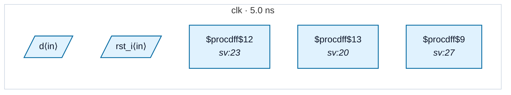

# Fixture: `good_rdc_002_resetless_producer`

<!-- generator: scripts/gen_fixture_docs.py -->

RDC-002 must stay silent when the producer flop is resetless (#306).

rst is a plain flop with no reset of its own (a $dff, so no ARST_VALUE). It drives the active-high async reset of rst_n, a local assert-async / deassert-sync stage. While rst is 1, rst_n is held in reset, which is the intended wiring. The producer has no reset value, so there is no polarity for the consumer to disagree with.

rst_n then drives q's active-low reset, and rst_n resets to 0, so that second hop matches too.

- **Status:** positive — textbook fix; analyzer must stay silent
- **Top module:** `good_rdc_002_resetless_producer`
- **Clocks:** `clk` (5.0 ns)
- **Crossings:** 0 structural (0 async-per-SDC, 0 sync)

## Clock-domain map

## Files

- `good_rdc_002_resetless_producer.json`
- `good_rdc_002_resetless_producer.sdc`
- `good_rdc_002_resetless_producer.sv`

---
*Generated by `scripts/gen_fixture_docs.py` — re-run after editing the SV/SDC/netlist.*
