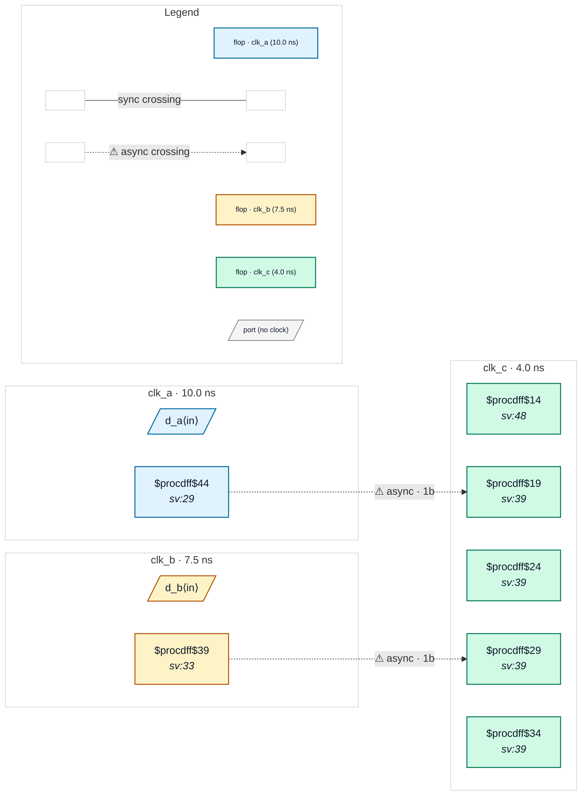

# Fixture: `good_reconvergence_two_source_domains`

<!-- generator: scripts/gen_fixture_docs.py -->

Positive fixture: signals from two different source domains are each synchronised once into a third domain and then combined (rtl-buddy-cdc#331).

clk_a, clk_b and clk_c are mutually asynchronous. a_q (clk_a) and b_q (clk_b) each cross into clk_c through their own 2FF synchroniser and the two synchronised values meet in one clk_c register. That is not reconvergence in CDC-005's sense: the rule is about ONE source flop whose value is resolved twice, independently, and then recombined. a_q and b_q are unrelated launches in unrelated domains, so there is no source-side relation for the combine to break, and every crossing is a 2FF synchroniser. Two async crossings, no finding.

```text
  clk_a [a_q] ──2FF──┐
                     ├─ & ─▶ [c_both] (clk_c)
  clk_b [b_q] ──2FF──┘
```

- **Status:** positive — textbook fix; analyzer must stay silent
- **Top module:** `good_reconvergence_two_source_domains`
- **Clocks:** `clk_a` (10.0 ns), `clk_b` (7.5 ns), `clk_c` (4.0 ns)
- **Crossings:** 2 structural (2 async-per-SDC, 0 sync)

## Clock-domain map



## Files

- `good_reconvergence_two_source_domains.json`
- `good_reconvergence_two_source_domains.sdc`
- `good_reconvergence_two_source_domains.sv`

---
*Generated by `scripts/gen_fixture_docs.py` — re-run after editing the SV/SDC/netlist.*
