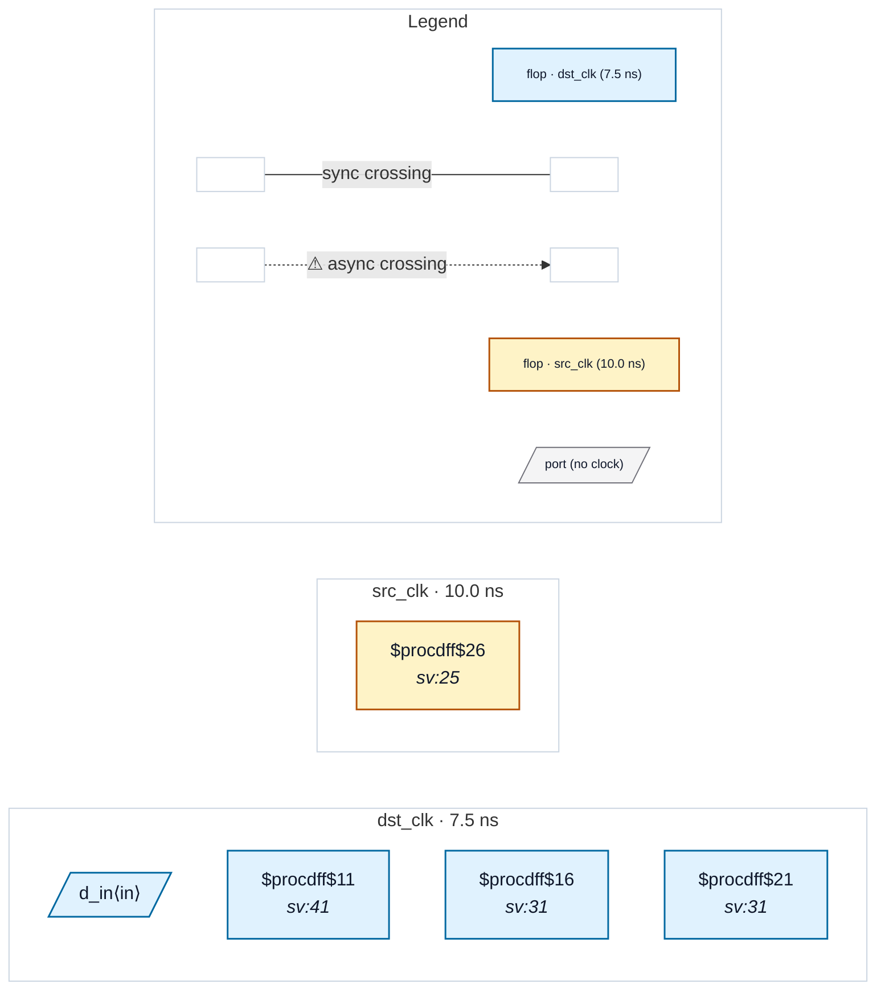

# Fixture: `good_reset_sync_foreign_reg`

<!-- generator: scripts/gen_fixture_docs.py -->

Reset synchroniser for a reset generated by a register in another clock domain (rtl-buddy-cdc#367).

`a_rst_n` is a src_clk register (async reset from the port `rst_n`). Two dst_clk flops form the textbook async-assert / sync-deassert synchroniser for it: async reset `a_rst_n`, head D tied to 1, Q->D chain. The data flop uses the synchroniser's output as its async reset. Taking a foreign-domain async reset on their own reset pin is what the synchroniser flops are for, so RDC-001 must stay silent: the only reset crossing is the one being synchronised.

Paired with `bad_reset_sync_foreign_reg` (single stage, backwards polarity, ordinary flop on the raw reset) and `good_reset_sync` (port-sourced reset).

- **Status:** positive — textbook fix; analyzer must stay silent
- **Top module:** `good_reset_sync_foreign_reg`
- **Clocks:** `dst_clk` (7.5 ns), `src_clk` (10.0 ns)
- **Crossings:** 0 structural (0 async-per-SDC, 0 sync)

## Clock-domain map

## Files

- `good_reset_sync_foreign_reg.json`
- `good_reset_sync_foreign_reg.sdc`
- `good_reset_sync_foreign_reg.sv`

---
*Generated by `scripts/gen_fixture_docs.py` — re-run after editing the SV/SDC/netlist.*
