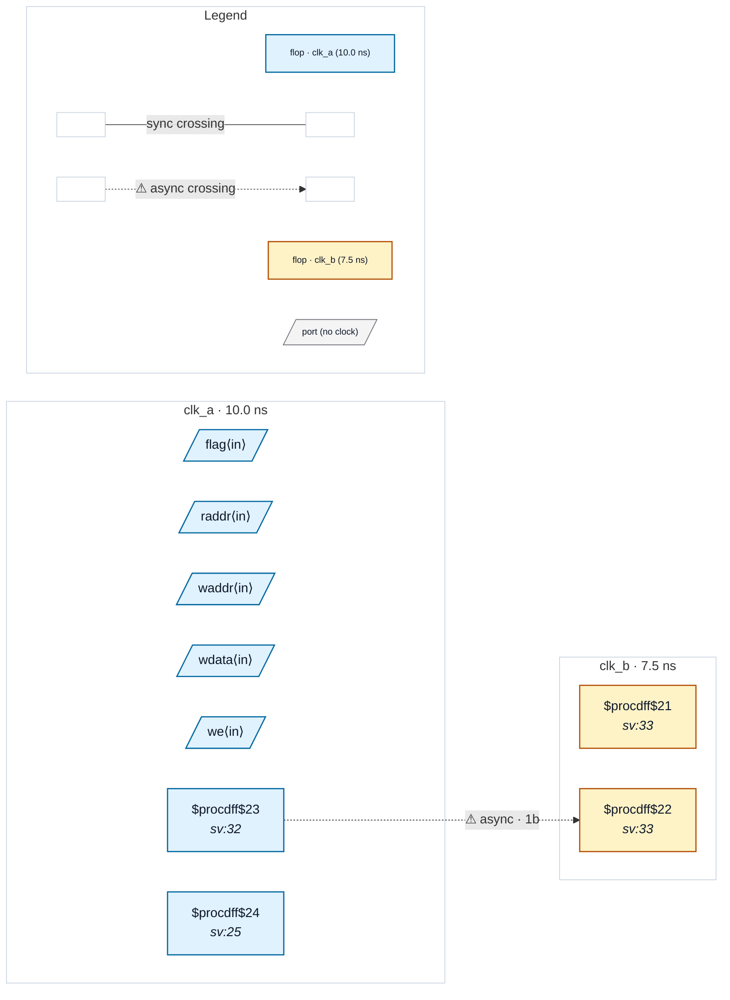

# Fixture: `good_same_clock_ram`

<!-- generator: scripts/gen_fixture_docs.py -->

Positive fixture for CDC-026 (issue #326): a single-clock RAM.

The 16 x 8 RAM is written and read (registered) on `clk_a`, with address, data and enable all from `clk_a`-typed ports. A separate single-bit signal crosses from `clk_a` to the asynchronous `clk_b` through a textbook 2FF synchroniser, so the design has a real asynchronous clock pair — but the memory itself never crosses it. A same-clock memory must be completely silent: no memory crossing, no finding.

- **Status:** positive — textbook fix; analyzer must stay silent
- **Top module:** `good_same_clock_ram`
- **Clocks:** `clk_a` (10.0 ns), `clk_b` (7.5 ns)
- **Crossings:** 1 structural (1 async-per-SDC, 0 sync)
- **Memory crossings:** 0 write→read storage path(s) (0 async-per-SDC)

## Clock-domain map

## Files

- `good_same_clock_ram.json`
- `good_same_clock_ram.sdc`
- `good_same_clock_ram.sv`

---
*Generated by `scripts/gen_fixture_docs.py` — re-run after editing the SV/SDC/netlist.*
