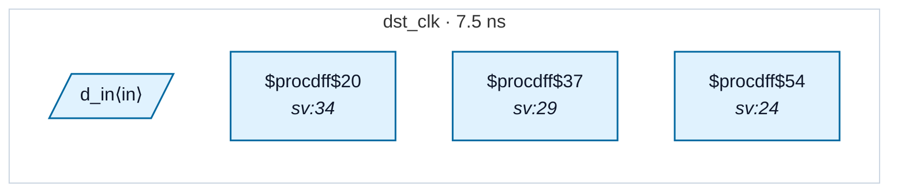

# Fixture: `good_set_clear_priority`

<!-- generator: scripts/gen_fixture_docs.py -->

Set / clear flops on reset ports, in every priority and polarity (rtl-buddy-cdc#383, rtl-buddy-cdc#378).

`proc` writes each as a `$dffsr` whose CLR and SET are muxes: the lower-priority pin is gated by the higher one (`SET = rst_n ? ~set_n : 0`, or `CLR = set_n ? ~rst_n : 0` when set wins) and an active-low control is an inverter mux. That is how Yosys encodes the flop, not a reset mux or two resets converging, so RDC-005 / RDC-006 must not fire on either pin. The data path is a plain dst_clk register. The committed `.synth.json` (gate level: `$_NOT_` / `$_AND_` on R and S) must agree: no finding.

- **Status:** positive — textbook fix; analyzer must stay silent
- **Top module:** `good_set_clear_priority`
- **Clocks:** `dst_clk` (7.5 ns)
- **Crossings:** 0 structural (0 async-per-SDC, 0 sync)

## Clock-domain map

## Files

- `good_set_clear_priority.json`
- `good_set_clear_priority.sdc`
- `good_set_clear_priority.sv`
- `good_set_clear_priority.synth.json`

---
*Generated by `scripts/gen_fixture_docs.py` — re-run after editing the SV/SDC/netlist.*
