# Fixture: `good_sync_reset_forms`

<!-- generator: scripts/gen_fixture_docs.py -->

Synchronous resets in the shapes `opt_dff` folds into SRST (rtl-buddy-cdc#394).

After `proc` alone each of these registers is a `$dff` with the reset left as constant-leg muxes on D; `opt_dff` and the slang frontend make them `$sdff` / `$sdffe` / `$sdffce` with the reset on SRST. The reset-domain classification must read every form alike:

```text
  q_hi   `if (r)`                      active high, port `r`
  q_lo   `if (!rn)`                    active low, port `rn`
  q_two  `if (r) ... else if (r2)`     two selects
  q_rov  reset over an enable          `$sdffe`
  q_eor  reset under an enable         `$sdffce`
  q_inf  reset from a register         inferred, `r_q`
  q_one  1-bit, resets to 1            active high, port `r`
```

One clock, every input typed to it: the design is clean. The `.optdff.json` netlist is the same design after `opt_dff`.

- **Status:** positive — textbook fix; analyzer must stay silent
- **Top module:** `good_sync_reset_forms`
- **Clocks:** `clk` (10.0 ns)
- **Crossings:** 0 structural (0 async-per-SDC, 0 sync)

## Clock-domain map

```mermaid
%% good_sync_reset_forms — generated by rtl-buddy-cdc render
flowchart LR
  subgraph clk_clk["clk · 10.0 ns"]
    direction TB
    p_in_d[/"d⟨in⟩"/]:::ckcls_clk
    p_in_en[/"en⟨in⟩"/]:::ckcls_clk
    p_in_r[/"r⟨in⟩"/]:::ckcls_clk
    p_in_r2[/"r2⟨in⟩"/]:::ckcls_clk
    p_in_rn[/"rn⟨in⟩"/]:::ckcls_clk
    f_9e060af5["$procdff$38<br/><i>sv:65</i>"]:::ckcls_clk
    f_15d7a384["$procdff$39<br/><i>sv:61</i>"]:::ckcls_clk
    f_9ebafce2["$procdff$40<br/><i>sv:55</i>"]:::ckcls_clk
    f_0f1459ff["$procdff$41<br/><i>sv:51</i>"]:::ckcls_clk
    f_28632a14["$procdff$42<br/><i>sv:46</i>"]:::ckcls_clk
    f_c0a4df5d["$procdff$43<br/><i>sv:42</i>"]:::ckcls_clk
    f_69bb3ac0["$procdff$44<br/><i>sv:38</i>"]:::ckcls_clk
    f_6c103289["$procdff$45<br/><i>sv:36</i>"]:::ckcls_clk
  end
  style clk_clk fill:none,stroke:#cbd5e1
  classDef ckcls_clk fill:#e0f2fe,stroke:#0369a1,stroke-width:1.5px,color:#0f172a
  classDef port_unassigned fill:#f4f4f5,stroke:#71717a,color:#0f172a
  classDef ckcls_legend_neutral fill:#ffffff,stroke:#cbd5e1,stroke-width:1px,color:#0f172a
```



## Files

- `good_sync_reset_forms.json`
- `good_sync_reset_forms.optdff.json`
- `good_sync_reset_forms.sdc`
- `good_sync_reset_forms.sv`

---
*Generated by `scripts/gen_fixture_docs.py` — re-run after editing the SV/SDC/netlist.*
