# Fixture: `good_sync_reset_lanes`

<!-- generator: scripts/gen_fixture_docs.py -->

Synchronous resets that differ by lane, or that one lowering folds into SRST in part (rtl-buddy-cdc#398).

`opt_dff` slices a register whose lanes are reset differently into one `$sdff` per reset; `proc` leaves one `$dff` with the resets as constant-leg muxes on D. The slang frontend folds the first select of `if (a) ... else if (b)` into SRST and leaves the second on D. The reset-domain map must list the same resets for every form:

```text
  q_split  lanes 1:0 reset by ra, 3:2 by rb      two slices
  q_part   lanes 1:0 reset by ra, 3:2 never      `$sdff` + `$dff`
  q_mix    `if (ra) 0101 else if (rb) 0011`      rb folds where the
                                                 constants agree
  q_two    `if (ra) ... else if (rb)`            ra | rb, `comb`
  q_two_n  `if (!ra) ... else if (!rb)`          `comb`, active low
  q_ce     the same under an enable              `$sdffce`
  q_rov    ra over an enable, rb under it        ra only
```

One clock, every input typed to it: the design is clean. The `.optdff.json` netlist is the same design after `opt_dff`.

- **Status:** positive — textbook fix; analyzer must stay silent
- **Top module:** `good_sync_reset_lanes`
- **Clocks:** `clk` (10.0 ns)
- **Crossings:** 0 structural (0 async-per-SDC, 0 sync)

## Clock-domain map

```mermaid
%% good_sync_reset_lanes — generated by rtl-buddy-cdc render
flowchart LR
  subgraph clk_clk["clk · 10.0 ns"]
    direction TB
    p_in_d[/"d⟨in⟩"/]:::ckcls_clk
    p_in_en[/"en⟨in⟩"/]:::ckcls_clk
    p_in_ra[/"ra⟨in⟩"/]:::ckcls_clk
    p_in_rb[/"rb⟨in⟩"/]:::ckcls_clk
    f_2a3bec37["$procdff$53<br/><i>sv:71</i>"]:::ckcls_clk
    f_ef29ac48["$procdff$54<br/><i>sv:64</i>"]:::ckcls_clk
    f_876dc4c5["$procdff$55<br/><i>sv:59</i>"]:::ckcls_clk
    f_53d4fb80["$procdff$56<br/><i>sv:54</i>"]:::ckcls_clk
    f_da0e1c2e["$procdff$57<br/><i>sv:49</i>"]:::ckcls_clk
    f_8824d0bf["$procdff$58<br/><i>sv:43</i>"]:::ckcls_clk
    f_659e93f8["$procdff$59<br/><i>sv:36</i>"]:::ckcls_clk
  end
  style clk_clk fill:none,stroke:#cbd5e1
  classDef ckcls_clk fill:#e0f2fe,stroke:#0369a1,stroke-width:1.5px,color:#0f172a
  classDef port_unassigned fill:#f4f4f5,stroke:#71717a,color:#0f172a
  classDef ckcls_legend_neutral fill:#ffffff,stroke:#cbd5e1,stroke-width:1px,color:#0f172a
```



## Files

- `good_sync_reset_lanes.json`
- `good_sync_reset_lanes.optdff.json`
- `good_sync_reset_lanes.sdc`
- `good_sync_reset_lanes.sv`

---
*Generated by `scripts/gen_fixture_docs.py` — re-run after editing the SV/SDC/netlist.*
