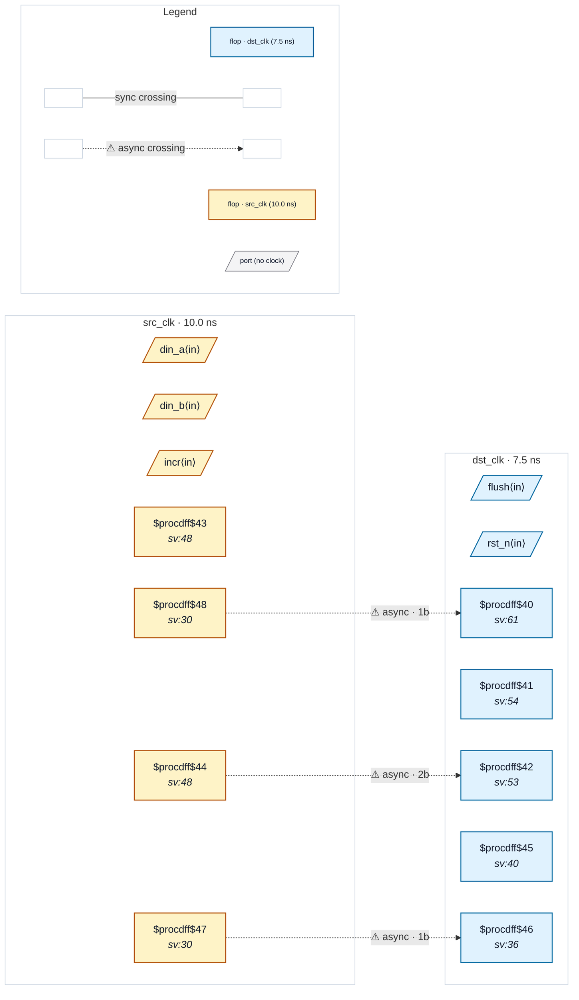

# Fixture: `good_sync_reset_mux_folds`

<!-- generator: scripts/gen_fixture_docs.py -->

Synchronisers whose sync resets `opt_dff` folds and a one-level, whole-vector look-through did not (rtl-buddy-cdc#390).

```text
  a1 / a2  two sync resets of one value, chained muxes on D
  g2       same, on the second stage of a gray-bus synchroniser
  bs       packed 2-stage shift, reset on the first lane only
```

`opt_dff` folds per lane, through every constant-leg mux whose constant matches the lane's reset value: a1 / a2 / g2 become `$sdff`s with SRST = !rst_n | flush, and bs is sliced into an `$sdff` (lane 0) and a `$dff` (lane 1). The `proc` form keeps the muxes; reading them one level and whole-vector only, it saw a depth-1 chain behind a1 (CDC-001), no second stage behind g1 (CDC-004) and a gate on the way into bs (CDC-003). All are clean synchronisers in every form. The committed `.optdff.json` holds the `opt_dff` form and must agree.

- **Status:** positive — textbook fix; analyzer must stay silent
- **Top module:** `good_sync_reset_mux_folds`
- **Clocks:** `dst_clk` (7.5 ns), `src_clk` (10.0 ns)
- **Crossings:** 3 structural (3 async-per-SDC, 0 sync)

## Clock-domain map



## Files

- `good_sync_reset_mux_folds.json`
- `good_sync_reset_mux_folds.optdff.json`
- `good_sync_reset_mux_folds.sdc`
- `good_sync_reset_mux_folds.sv`

---
*Generated by `scripts/gen_fixture_docs.py` — re-run after editing the SV/SDC/netlist.*
