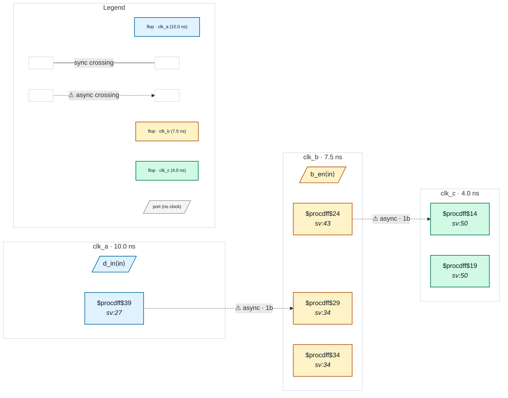

# Fixture: `good_three_domain_chain`

<!-- generator: scripts/gen_fixture_docs.py -->

Positive fixture: a control bit relayed through three asynchronous domains, A → B → C (rtl-buddy-cdc#331).

clk_a, clk_b and clk_c sit in three groups of one set_clock_groups -asynchronous, so each hop is a crossing. a_q crosses into clk_b through a 2FF synchroniser, clk_b registers the synchronised value (gated by a clk_b enable), and b_q crosses into clk_c through a second 2FF synchroniser. Two async crossings, both with depth 2, so CDC-001 / CDC-002 stay silent; the A → C relation is never a crossing of its own because no clk_c flop reads a clk_a flop.

```text
   clk_a          clk_b                         clk_c
  [ a_q ]──▶[ b_s1 ]─[ b_s2 ]─&─[ b_q ]──▶[ c_s1 ]─[ c_s2 ]──▶ q_out
  2FF at both hops → clean
```

- **Status:** positive — textbook fix; analyzer must stay silent
- **Top module:** `good_three_domain_chain`
- **Clocks:** `clk_a` (10.0 ns), `clk_b` (7.5 ns), `clk_c` (4.0 ns)
- **Crossings:** 2 structural (2 async-per-SDC, 0 sync)

## Clock-domain map



## Files

- `good_three_domain_chain.json`
- `good_three_domain_chain.sdc`
- `good_three_domain_chain.sv`

---
*Generated by `scripts/gen_fixture_docs.py` — re-run after editing the SV/SDC/netlist.*
