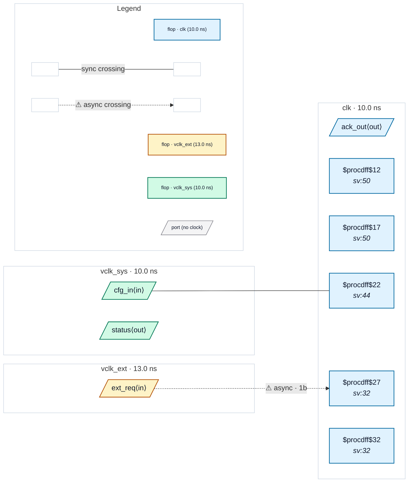

# Fixture: `good_virtual_clock_io`

<!-- generator: scripts/gen_fixture_docs.py -->

Positive fixture: virtual clocks typing top-level inputs and outputs (rtl-buddy-cdc#331).

```text
clk is the only clock with a port. Two virtual clocks (create_clock
with no source object) describe the outside world: vclk_ext, an
external agent declared asynchronous to clk, and vclk_sys, the board
clock clk is derived from (no group separates it from clk, so the two
are related and timed together).
  ext_req  set_input_delay -clock vclk_ext: a port-sourced async
           crossing into clk, landing in a 2FF synchroniser
  cfg_in   set_input_delay -clock vclk_sys: synchronous, a plain register
  status   set_output_delay -clock vclk_sys, launched in clk: the
           receiver's clock is related to the launch (CDC-024 silent)
  ack_out  set_output_delay -clock clk, launched in clk
Every output has a contract (CDC-025 silent). One async crossing, no
finding.
```

```text
  ext_req (vclk_ext) ──2FF──▶ clk     cfg_in (vclk_sys) ──▶ [cfg_q] clk
  [st_q] clk ──▶ status (vclk_sys)    [ack_q] clk ──▶ ack_out (clk)
```

- **Status:** positive — textbook fix; analyzer must stay silent
- **Top module:** `good_virtual_clock_io`
- **Clocks:** `clk` (10.0 ns), `vclk_ext` (13.0 ns), `vclk_sys` (10.0 ns)
- **Crossings:** 2 structural (1 async-per-SDC, 1 sync)

## Clock-domain map



## Files

- `good_virtual_clock_io.json`
- `good_virtual_clock_io.sdc`
- `good_virtual_clock_io.sv`

---
*Generated by `scripts/gen_fixture_docs.py` — re-run after editing the SV/SDC/netlist.*
