# Fixture: `scaling_perf`

<!-- generator: scripts/gen_fixture_docs.py -->

PERF FIXTURE (rtl-buddy-cdc#253) — hierarchical/abstraction scaling.

50 instances of a single-clock pipeline subtree `pipe` (each 20 clk_a flops, carrying NO crossing) plus a tiny 2-clock CDC fabric with exactly one real async crossing (clk_a -> clk_b). The FLAT netlist has every pipe flop present (the analyzer walks them all); the BLACKBOXED netlist summarises each single-clock pipe to its port boundary, so the analyzer walks only the fabric flops. Both variants report the SAME one async crossing — that parity, with far fewer flops walked, is the win.

- **Status:** auxiliary
- **Top module:** `scaling_perf`
- **Clocks:** `clk_a` (10.0 ns), `clk_b` (7.0 ns)
- **Crossings:** 1 structural (1 async-per-SDC, 0 sync)

## Clock-domain map

```mermaid
%% top — generated by rtl-buddy-cdc render
flowchart LR
  subgraph clk_clk_a["clk_a · 10.0 ns"]
    direction TB
    p_in_d_in[/"d_in⟨in⟩"/]:::ckcls_clk_a
    f_db195da0["$driver$cdc_src<br/><i>sv:368</i>"]:::ckcls_clk_a
    f_c149f356["$driver$snk_0<br/><i>sv:70</i>"]:::ckcls_clk_a
    f_f7ed5362["$driver$snk_1<br/><i>sv:76</i>"]:::ckcls_clk_a
    f_9386287f["$driver$snk_10<br/><i>sv:130</i>"]:::ckcls_clk_a
    f_1aad8559["$driver$snk_11<br/><i>sv:136</i>"]:::ckcls_clk_a
    f_548bf052["$driver$snk_12<br/><i>sv:142</i>"]:::ckcls_clk_a
    f_7c34f482["$driver$snk_13<br/><i>sv:148</i>"]:::ckcls_clk_a
    f_66347f8e["$driver$snk_14<br/><i>sv:154</i>"]:::ckcls_clk_a
    f_604180df["$driver$snk_15<br/><i>sv:160</i>"]:::ckcls_clk_a
    f_094a5ef6["$driver$snk_16<br/><i>sv:166</i>"]:::ckcls_clk_a
    f_98561477["$driver$snk_17<br/><i>sv:172</i>"]:::ckcls_clk_a
    f_4da3c0d3["$driver$snk_18<br/><i>sv:178</i>"]:::ckcls_clk_a
    f_40179828["$driver$snk_19<br/><i>sv:184</i>"]:::ckcls_clk_a
    f_94238b59["$driver$snk_2<br/><i>sv:82</i>"]:::ckcls_clk_a
    f_565bb64b["$driver$snk_20<br/><i>sv:190</i>"]:::ckcls_clk_a
    f_03a0f655["$driver$snk_21<br/><i>sv:196</i>"]:::ckcls_clk_a
    f_db468c07["$driver$snk_22<br/><i>sv:202</i>"]:::ckcls_clk_a
    f_14c7b753["$driver$snk_23<br/><i>sv:208</i>"]:::ckcls_clk_a
    f_19088c0c["$driver$snk_24<br/><i>sv:214</i>"]:::ckcls_clk_a
    f_d24dc272["$driver$snk_25<br/><i>sv:220</i>"]:::ckcls_clk_a
    f_afc9cb9a["$driver$snk_26<br/><i>sv:226</i>"]:::ckcls_clk_a
    f_ca41793d["$driver$snk_27<br/><i>sv:232</i>"]:::ckcls_clk_a
    f_19fc2b6c["$driver$snk_28<br/><i>sv:238</i>"]:::ckcls_clk_a
    f_850d96b4["$driver$snk_29<br/><i>sv:244</i>"]:::ckcls_clk_a
    f_5ca236bc["$driver$snk_3<br/><i>sv:88</i>"]:::ckcls_clk_a
    f_36247dc0["$driver$snk_30<br/><i>sv:250</i>"]:::ckcls_clk_a
    f_19d9c160["$driver$snk_31<br/><i>sv:256</i>"]:::ckcls_clk_a
    f_5d6abe63["$driver$snk_32<br/><i>sv:262</i>"]:::ckcls_clk_a
    f_ac7ed825["$driver$snk_33<br/><i>sv:268</i>"]:::ckcls_clk_a
    f_6f9cfa57["$driver$snk_34<br/><i>sv:274</i>"]:::ckcls_clk_a
    f_556aac99["$driver$snk_35<br/><i>sv:280</i>"]:::ckcls_clk_a
    f_0bd9a965["$driver$snk_36<br/><i>sv:286</i>"]:::ckcls_clk_a
    f_e73b0ff2["$driver$snk_37<br/><i>sv:292</i>"]:::ckcls_clk_a
    f_5d1de9b4["$driver$snk_38<br/><i>sv:298</i>"]:::ckcls_clk_a
    f_808ba4a4["$driver$snk_39<br/><i>sv:304</i>"]:::ckcls_clk_a
    f_3dcf1d9b["$driver$snk_4<br/><i>sv:94</i>"]:::ckcls_clk_a
    f_d42cf1b8["$driver$snk_40<br/><i>sv:310</i>"]:::ckcls_clk_a
    f_324773ae["$driver$snk_41<br/><i>sv:316</i>"]:::ckcls_clk_a
    f_af7e3ac0["$driver$snk_42<br/><i>sv:322</i>"]:::ckcls_clk_a
    f_931a9dab["$driver$snk_43<br/><i>sv:328</i>"]:::ckcls_clk_a
    f_c8710fae["$driver$snk_44<br/><i>sv:334</i>"]:::ckcls_clk_a
    f_1473b75e["$driver$snk_45<br/><i>sv:340</i>"]:::ckcls_clk_a
    f_cc89d1d3["$driver$snk_46<br/><i>sv:346</i>"]:::ckcls_clk_a
    f_c4cfeedd["$driver$snk_47<br/><i>sv:352</i>"]:::ckcls_clk_a
    f_2f529ab1["$driver$snk_48<br/><i>sv:358</i>"]:::ckcls_clk_a
    f_239efd14["$driver$snk_49<br/><i>sv:364</i>"]:::ckcls_clk_a
    f_449e45fa["$driver$snk_5<br/><i>sv:100</i>"]:::ckcls_clk_a
    f_a8da5a8d["$driver$snk_6<br/><i>sv:106</i>"]:::ckcls_clk_a
    f_1eda536b["$driver$snk_7<br/><i>sv:112</i>"]:::ckcls_clk_a
    f_fb2c3f17["$driver$snk_8<br/><i>sv:118</i>"]:::ckcls_clk_a
    f_ccbb0f67["$driver$snk_9<br/><i>sv:124</i>"]:::ckcls_clk_a
    f_7467ccff["$driver$src_0<br/><i>sv:68</i>"]:::ckcls_clk_a
    f_b073cc47["$driver$src_1<br/><i>sv:74</i>"]:::ckcls_clk_a
    f_d3500f16["$driver$src_10<br/><i>sv:128</i>"]:::ckcls_clk_a
    f_59cbfb06["$driver$src_11<br/><i>sv:134</i>"]:::ckcls_clk_a
    f_a84b1a14["$driver$src_12<br/><i>sv:140</i>"]:::ckcls_clk_a
    f_eb0d42f0["$driver$src_13<br/><i>sv:146</i>"]:::ckcls_clk_a
    f_271b9631["$driver$src_14<br/><i>sv:152</i>"]:::ckcls_clk_a
    f_f13e56a3["$driver$src_15<br/><i>sv:158</i>"]:::ckcls_clk_a
    f_62e4e11f["$driver$src_16<br/><i>sv:164</i>"]:::ckcls_clk_a
    f_8592493a["$driver$src_17<br/><i>sv:170</i>"]:::ckcls_clk_a
    f_98c1b8ae["$driver$src_18<br/><i>sv:176</i>"]:::ckcls_clk_a
    f_b62bd38a["$driver$src_19<br/><i>sv:182</i>"]:::ckcls_clk_a
    f_01956c68["$driver$src_2<br/><i>sv:80</i>"]:::ckcls_clk_a
    f_cc17154c["$driver$src_20<br/><i>sv:188</i>"]:::ckcls_clk_a
    f_ab900533["$driver$src_21<br/><i>sv:194</i>"]:::ckcls_clk_a
    f_2390375a["$driver$src_22<br/><i>sv:200</i>"]:::ckcls_clk_a
    f_0a9df908["$driver$src_23<br/><i>sv:206</i>"]:::ckcls_clk_a
    f_e58629af["$driver$src_24<br/><i>sv:212</i>"]:::ckcls_clk_a
    f_086015b1["$driver$src_25<br/><i>sv:218</i>"]:::ckcls_clk_a
    f_4d859b5a["$driver$src_26<br/><i>sv:224</i>"]:::ckcls_clk_a
    f_361ae068["$driver$src_27<br/><i>sv:230</i>"]:::ckcls_clk_a
    f_8437dc21["$driver$src_28<br/><i>sv:236</i>"]:::ckcls_clk_a
    f_450013d6["$driver$src_29<br/><i>sv:242</i>"]:::ckcls_clk_a
    f_4e411964["$driver$src_3<br/><i>sv:86</i>"]:::ckcls_clk_a
    f_fd29e32b["$driver$src_30<br/><i>sv:248</i>"]:::ckcls_clk_a
    f_7b0f1503["$driver$src_31<br/><i>sv:254</i>"]:::ckcls_clk_a
    f_45e504e9["$driver$src_32<br/><i>sv:260</i>"]:::ckcls_clk_a
    f_ef7a3fe5["$driver$src_33<br/><i>sv:266</i>"]:::ckcls_clk_a
    f_4d097608["$driver$src_34<br/><i>sv:272</i>"]:::ckcls_clk_a
    f_4194c1f3["$driver$src_35<br/><i>sv:278</i>"]:::ckcls_clk_a
    f_ff35b450["$driver$src_36<br/><i>sv:284</i>"]:::ckcls_clk_a
    f_5a311df7["$driver$src_37<br/><i>sv:290</i>"]:::ckcls_clk_a
    f_cf4b2d6d["$driver$src_38<br/><i>sv:296</i>"]:::ckcls_clk_a
    f_e358c217["$driver$src_39<br/><i>sv:302</i>"]:::ckcls_clk_a
    f_754132e0["$driver$src_4<br/><i>sv:92</i>"]:::ckcls_clk_a
    f_d6923205["$driver$src_40<br/><i>sv:308</i>"]:::ckcls_clk_a
    f_aa29516c["$driver$src_41<br/><i>sv:314</i>"]:::ckcls_clk_a
    f_182a95ae["$driver$src_42<br/><i>sv:320</i>"]:::ckcls_clk_a
    f_f6fb0c4f["$driver$src_43<br/><i>sv:326</i>"]:::ckcls_clk_a
    f_bef8a64b["$driver$src_44<br/><i>sv:332</i>"]:::ckcls_clk_a
    f_0c4be983["$driver$src_45<br/><i>sv:338</i>"]:::ckcls_clk_a
    f_acceb0b7["$driver$src_46<br/><i>sv:344</i>"]:::ckcls_clk_a
    f_851a43c2["$driver$src_47<br/><i>sv:350</i>"]:::ckcls_clk_a
    f_a9bd9465["$driver$src_48<br/><i>sv:356</i>"]:::ckcls_clk_a
    f_34348122["$driver$src_49<br/><i>sv:362</i>"]:::ckcls_clk_a
    f_d0865a01["$driver$src_5<br/><i>sv:98</i>"]:::ckcls_clk_a
    f_07d21669["$driver$src_6<br/><i>sv:104</i>"]:::ckcls_clk_a
    f_dbd512da["$driver$src_7<br/><i>sv:110</i>"]:::ckcls_clk_a
    f_8262f51e["$driver$src_8<br/><i>sv:116</i>"]:::ckcls_clk_a
    f_7346408e["$driver$src_9<br/><i>sv:122</i>"]:::ckcls_clk_a
  end
  subgraph clk_clk_b["clk_b · 7.0 ns"]
    direction TB
    f_17d9b615["$driver$cdc_dst<br/><i>sv:369</i>"]:::ckcls_clk_b
  end
  f_db195da0 -. "⚠ async · 4b" .-> f_17d9b615
  subgraph rb_legend["Legend"]
    direction LR
    lg_clk_clk_a["flop · clk_a (10.0 ns)"]:::ckcls_clk_a
    lg_clk_clk_b["flop · clk_b (7.0 ns)"]:::ckcls_clk_b
    lg_port[/"port (no clock)"/]:::port_unassigned
    lg_sync_a[" "]:::ckcls_legend_neutral
    lg_sync_b[" "]:::ckcls_legend_neutral
    lg_async_a[" "]:::ckcls_legend_neutral
    lg_async_b[" "]:::ckcls_legend_neutral
    lg_sync_a --- |"sync crossing"| lg_sync_b
    lg_async_a -. "⚠ async crossing" .-> lg_async_b
  end
  style clk_clk_a fill:none,stroke:#cbd5e1
  style clk_clk_b fill:none,stroke:#cbd5e1
  style rb_legend fill:none,stroke:#cbd5e1
  style lg_clk_clk_a font-size:11px
  style lg_clk_clk_b font-size:11px
  style lg_port font-size:11px
  style lg_sync_a font-size:11px
  style lg_sync_b font-size:11px
  style lg_async_a font-size:11px
  style lg_async_b font-size:11px
  classDef ckcls_clk_a fill:#e0f2fe,stroke:#0369a1,stroke-width:1.5px,color:#0f172a
  classDef ckcls_clk_b fill:#fef3c7,stroke:#b45309,stroke-width:1.5px,color:#0f172a
  classDef port_unassigned fill:#f4f4f5,stroke:#71717a,color:#0f172a
  classDef ckcls_legend_neutral fill:#ffffff,stroke:#cbd5e1,stroke-width:1px,color:#0f172a
```

## Files

- `scaling_perf.flat.json`
- `scaling_perf.json`
- `scaling_perf.sdc`
- `scaling_perf.sv`

---
*Generated by `scripts/gen_fixture_docs.py` — re-run after editing the SV/SDC/netlist.*
