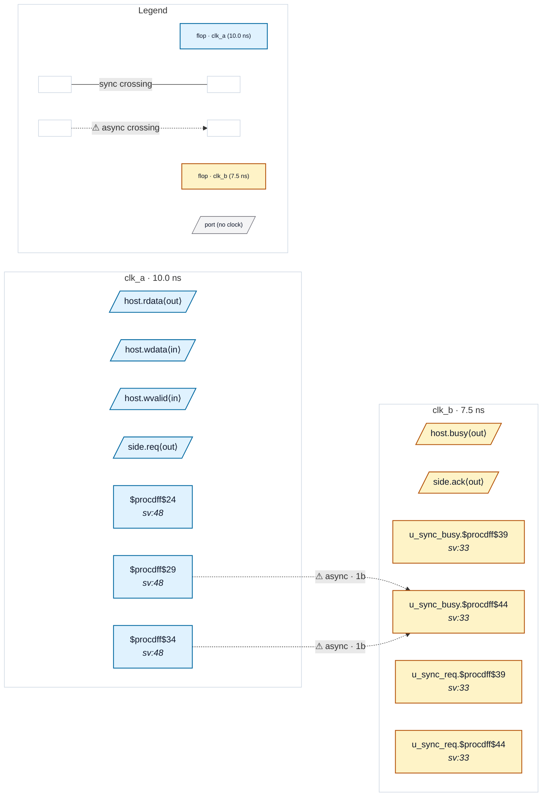

# Fixture: `slang_iface_port_members`

<!-- generator: scripts/gen_fixture_docs.py -->

Block whose host bus is a top-level SystemVerilog interface port (rtl-buddy-cdc#414). Each member of an unbound top-level interface port is a top-level port of the netlist, named <port>.<member> as Yosys read_verilog names it (host.wdata, side.ack), so the SDC types it with [get_ports host.wdata] or a host.* glob. Its direction is how the design uses it: a member the design drives is an output, any other an input (with or without a modport). Yosys read_verilog, which renders this page, makes a member without a modport an inout instead: not a crossing source, which the run reports.

```text
  - host (modport sub): wdata / wvalid are inputs captured in clk_a;
    rdata is an output; busy is an output whose only driver is the
    u_sync_busy 2FF synchroniser into clk_b, fed by a comparator of
    two clk_a flops (CDC-003). That cone is observed by nothing but
    the interface member: 0.8.0 dropped it, and the finding with it.
  - side (bare interface type, no modport): req is read (an input
    synchronised into clk_b by u_sync_req), ack is written (an output).
```

- **Status:** auxiliary
- **Top module:** `slang_iface_port_members`
- **Clocks:** `clk_a` (10.0 ns), `clk_b` (7.5 ns)
- **Crossings:** 2 structural (2 async-per-SDC, 0 sync)

## Clock-domain map



## Files

- `slang_iface_port_members.sdc`
- `slang_iface_port_members.sv`

---
*Generated by `scripts/gen_fixture_docs.py` — re-run after editing the SV/SDC/netlist.*
