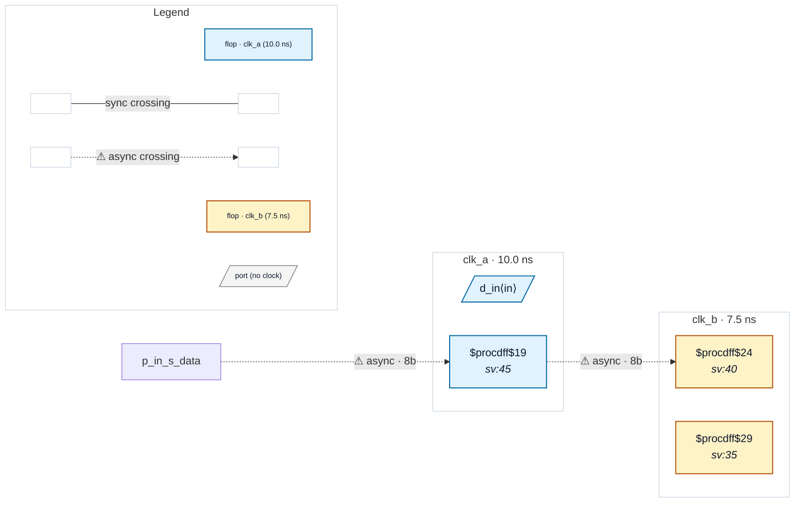

# Fixture: `slang_iface_port_top`

<!-- generator: scripts/gen_fixture_docs.py -->

Standalone block whose top exercises two yosys-slang strict-default rejections that a *block-level* CDC lint must tolerate:

```text
  1. an unconnected top-level SystemVerilog interface port
     (`bus_if.sink s`) — normal when a block is linted on its own,
     with no parent to bind the interface;
  2. a module-item reference to a net declared later in the same
     module (`sync_q <= meta;` with `meta` declared below) — valid
     RTL the built-in read_verilog frontend already accepts.
```

read_slang rejects both by default; rtl-buddy-cdc invokes it with --allow-toplevel-iface-ports / --allow-use-before-declare so the read_slang frontend stays as lenient as read_verilog. The design also carries a real clk_a -> clk_b 8-bit bus crossing (through a 2FF sync) so a green elaboration yields an analysable netlist (CDC-004).

- **Status:** auxiliary
- **Top module:** `slang_iface_port_top`
- **Clocks:** `clk_a` (10.0 ns), `clk_b` (7.5 ns)
- **Crossings:** 2 structural (2 async-per-SDC, 0 sync)

## Clock-domain map



## Files

- `slang_iface_port_top.sdc`
- `slang_iface_port_top.sv`

---
*Generated by `scripts/gen_fixture_docs.py` — re-run after editing the SV/SDC/netlist.*
