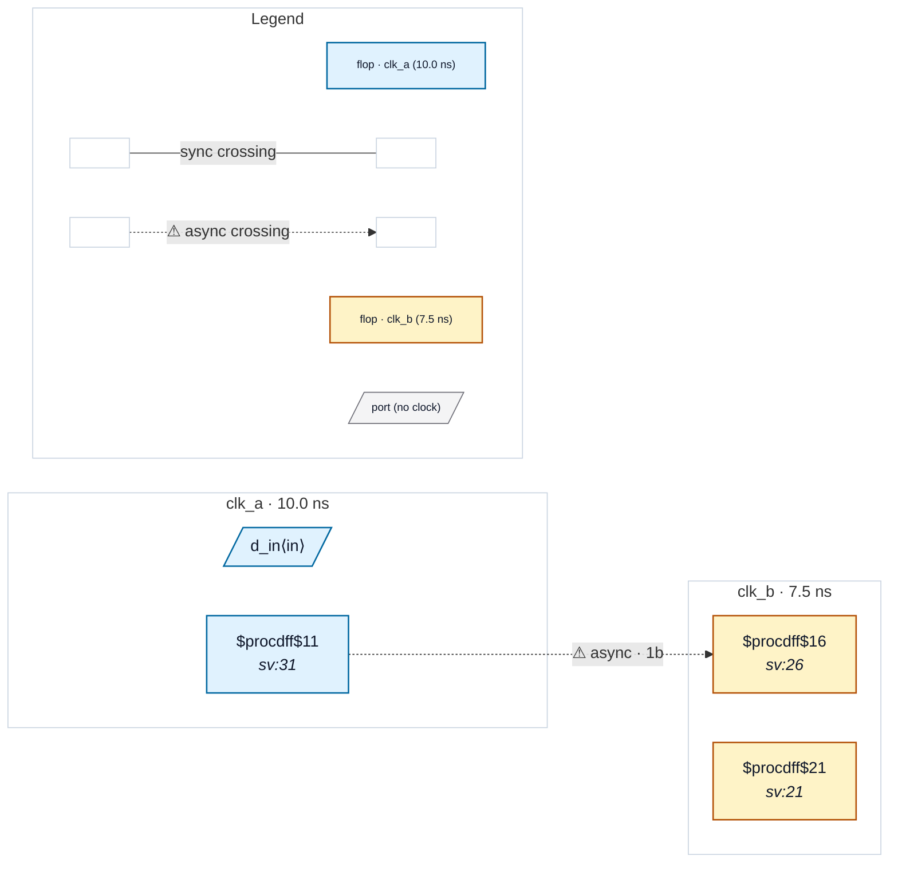

# Fixture: `slang_use_before_decl`

<!-- generator: scripts/gen_fixture_docs.py -->

A module-item reference to a net declared later in the same module (`sync_q <= meta;` with `meta` declared below). Valid SystemVerilog that the built-in read_verilog frontend accepts, but yosys-slang's read_slang rejects by default. rtl-buddy-cdc passes --allow-use-before-declare so the read_slang frontend stays as lenient as read_verilog.

Carries a clk_a -> clk_b control crossing through a 2FF synchroniser so a green elaboration yields an analysable, violation-free netlist.

- **Status:** auxiliary
- **Top module:** `slang_use_before_decl`
- **Clocks:** `clk_a` (10.0 ns), `clk_b` (7.5 ns)
- **Crossings:** 1 structural (1 async-per-SDC, 0 sync)

## Clock-domain map

## Files

- `slang_use_before_decl.sdc`
- `slang_use_before_decl.sv`

---
*Generated by `scripts/gen_fixture_docs.py` — re-run after editing the SV/SDC/netlist.*
