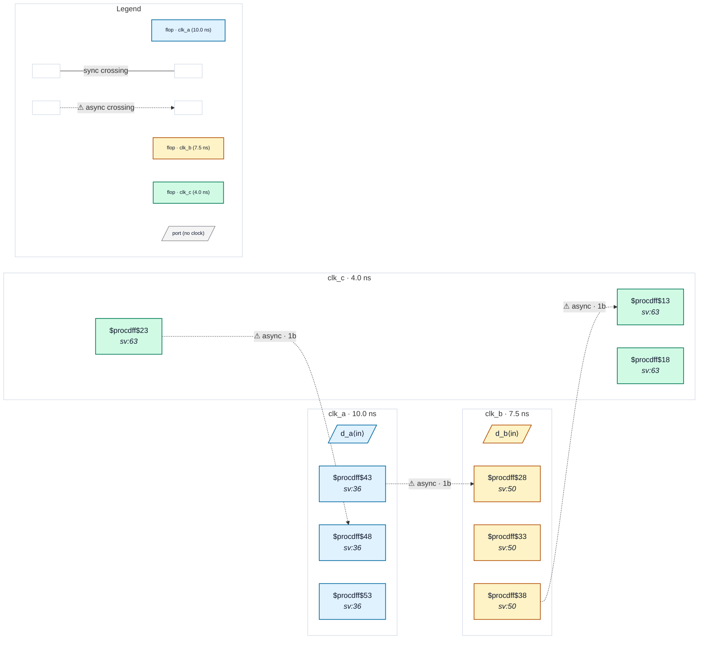

# Fixture: `tcl_generated_constraints`

<!-- generator: scripts/gen_fixture_docs.py -->

Auxiliary fixture: constraints generated by Tcl (variables, expr, lists, foreach) rather than written out one command per line (rtl-buddy-cdc#331).

Three asynchronous clocks in a ring, every hop through a 2FF synchroniser: clk_a → clk_b → clk_c → clk_a. The SDC declares none of it literally. A clock table (a Tcl list of name / period pairs) drives a foreach that emits each create_clock and collects one -group per clock into a list, expanded into a single set_clock_groups with {*}; a second foreach types the data inputs with set_input_delay at [expr {0.1 * $period}].

tcl backend: the file is evaluated, so the SDC declares three clocks in three async groups and two typed inputs. Three async crossings, all 2FF: clean. tokenizer backend: $var, expr and foreach are not evaluated, so the file declares nothing. Its verdict is pinned separately by the test: see tests/test_sdc_variety_fixtures.py.

```text
  clk_a ──2FF──▶ clk_b ──2FF──▶ clk_c ──2FF──▶ clk_a
```

- **Status:** auxiliary
- **Top module:** `tcl_generated_constraints`
- **Clocks:** `clk_a` (10.0 ns), `clk_b` (7.5 ns), `clk_c` (4.0 ns)
- **Crossings:** 3 structural (3 async-per-SDC, 0 sync)

## Clock-domain map



## Files

- `tcl_generated_constraints.json`
- `tcl_generated_constraints.sdc`
- `tcl_generated_constraints.sv`

---
*Generated by `scripts/gen_fixture_docs.py` — re-run after editing the SV/SDC/netlist.*
